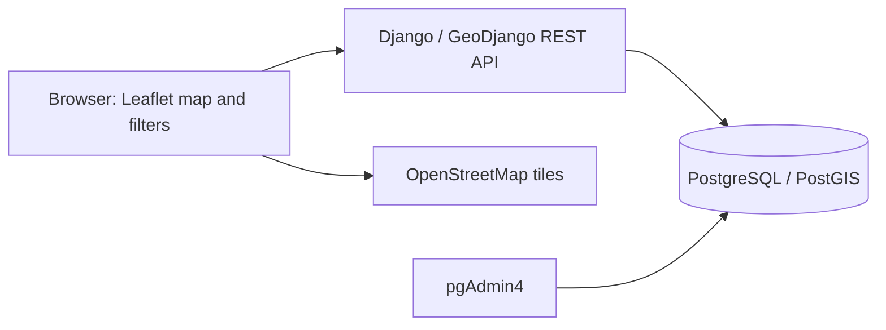

# StudySmart

StudySmart is an individual Advanced Web Mapping / Location-Based Services university project. Its aim is to help students find study spaces in Dublin through an interactive map, spatial searches and facility filters.

## Project status

The repository is at the initial planning stage. It currently contains project development instructions in [AGENTS.md](AGENTS.md) and a PyCharm sample script (`main.py`). The web application, database, API, data imports and Docker configuration have not been implemented.

The features and architecture below describe the planned application, not working functionality.

## Planned features

- Interactive map of libraries, university study spaces and study-friendly cafes.
- Search within a radius around a selected point.
- Find the nearest study spaces with distance information.
- Filter by space type, Wi-Fi, power outlets and quiet environment where reliable data exists.
- Authenticated administrator access to create, view, update and delete study spaces.
- Administrative-area containment searches and counts of study spaces per area.

Live occupancy, reservations, ratings, route optimisation, public user accounts and AI recommendations are outside the agreed MVP.

## Planned technology and architecture

| Component | Technology and responsibility |
| --- | --- |
| Frontend | HTML, CSS, JavaScript, Bootstrap 5 and Leaflet with OpenStreetMap base tiles |
| Application and API | Django, GeoDjango and Django REST Framework |
| Spatial database | PostgreSQL with PostGIS |
| Local deployment | Docker Compose with separate Django, PostGIS and pgAdmin4 services |

Radius, nearest-space and containment queries will run in GeoDjango/PostGIS. Public API access is planned for reads; writes will require authenticated administrator permissions.

## Planned data model

| Model | Intended fields |
| --- | --- |
| `StudySpace` | Name, type, location (`PointField`, SRID 4326), optional address and description, nullable facility attributes and source metadata |
| `AdministrativeArea` | Name and polygon or multipolygon boundary |

Unknown facility attributes must remain unknown rather than being recorded as false. Data sources, retrieval dates, licences and attribution must be recorded. Authoritative, OpenStreetMap, manually verified and demonstration records must be distinguishable. Imports should be reproducible and idempotent, with explicit coordinate reference system handling and geometry validation.

No datasets have been imported or verified yet. Dataset-specific attribution will be added when sources are selected; OpenStreetMap attribution must be displayed when its maps or data are used.

## Local setup

There is no runnable StudySmart application yet. No dependency manifest, Django `manage.py`, Docker Compose file or environment template is currently provided, so installation, migration and startup commands cannot yet be documented or verified.

The intended setup will use Docker Engine with Docker Compose. Once the application is scaffolded, this section should include exact commands for:

1. Creating local environment configuration from a tracked `.env.example` containing placeholders only.
2. Building and starting the application and database services.
3. Applying database migrations and creating an administrator.
4. Importing the selected spatial datasets.
5. Opening the map, API and administration interface.
6. Running checks and tests.

Keep credentials and Django secret keys in local environment variables or ignored environment files. Database and pgAdmin services should not be exposed unnecessarily.

## Testing and documentation

No application tests exist yet, and application startup has not been verified. Planned coverage includes:

- Model and serializer validation, including coordinate and radius bounds.
- Public read access and administrator-only write permissions.
- Radius, nearest-space and containment/count queries.
- Missing coordinates, invalid radii, empty results and unknown facilities.
- Geometry transformations and repeat imports without duplicates.

API routes and examples, the implemented schema, screenshots, dataset licences and clean-start verification results will be documented as those parts are implemented.
