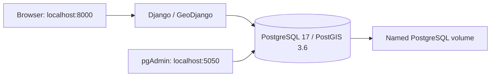

# StudySmart

StudySmart is an individual Advanced Web Mapping / Location-Based Services university project to help students find study spaces in Dublin.

## Current scope

Issue #1 provides a Django project (`studysmart`), an app (`spaces`), a simple page at `/`, and a Docker development environment with PostGIS and pgAdmin4.

Issue #2 adds a shared `StudySpace` model for libraries and cafés, five nullable facility fields, administrative-area multipolygons, repeatable snapshot imports and Django-admin editing. Source metadata, retrieval times, licences and original attributes are preserved. Unknown facilities remain SQL NULL.

Public spatial APIs, map controls and Leaflet features remain for later issues. The home page is still an initial development page, not a study-space search interface.

## Architecture



All three services share a dedicated bridge network with an explicit private subnet. Docker DNS resolves the database as `db`; container addresses are not hard-coded. Only the Django and pgAdmin ports are published, both on the host loopback interface. PostgreSQL has no host port.

Dependencies are Django 5.2 LTS (which includes GeoDjango), Django REST Framework and Psycopg 3. Python 3.12 and GEOS/GDAL/PROJ run inside the Django container. Compose passes environment variables to Django, so no dotenv package is required. Django's development server is used; this is not a production deployment.

## Prerequisites

- Docker Desktop running **Linux containers**, with its WSL 2 backend recommended on Windows.
- Docker Compose supporting health-based dependencies.
- Internet access for the initial image and package downloads.
- Available host ports 8000 and 5050.
- A private subnet that does not overlap your local, VPN or other Docker networks.

A host Python installation is not required for the commands below. Run them from the repository root in PowerShell or the PyCharm terminal.

## Environment configuration

For a new checkout only:

```powershell
Copy-Item .env.example .env
```

Do not overwrite an existing `.env`. Replace the `change-me` values with unique local secrets before starting. Settings reject missing secrets and the provided placeholders.

| Variable | Purpose |
| --- | --- |
| `DJANGO_SECRET_KEY` | Long random Django signing secret |
| `DJANGO_DEBUG` | Exactly `True` or `False`; defaults to false if absent |
| `DJANGO_ALLOWED_HOSTS` | Comma-separated hostnames; local defaults exclude wildcards |
| `POSTGRES_DB` | Database created on first initialisation |
| `POSTGRES_USER` | Local development database account |
| `POSTGRES_PASSWORD` | Unique database password |
| `PGADMIN_DEFAULT_EMAIL` | pgAdmin login email |
| `PGADMIN_DEFAULT_PASSWORD` | Separate pgAdmin password |
| `DOCKER_SUBNET` | Dedicated subnet; defaults to `172.30.50.0/24` |

A PowerShell 5.1-compatible way to generate one random secret is:

```powershell
$generator = [System.Security.Cryptography.RandomNumberGenerator]::Create()
$secretBytes = New-Object byte[] 48
$generator.GetBytes($secretBytes)
[BitConverter]::ToString($secretBytes).Replace('-', '').ToLowerInvariant()
$generator.Dispose()
```

Repeat for each secret and enter the values locally. Do not share the output. Single-quoted values in `.env` preserve literal `$` and `#` characters.

`.env` is ignored by Git and excluded from Docker's build context. `.env.example` contains placeholders only. Compose explicitly passes only the environment variables each service needs. Django does not load `.env` directly.

## Start the environment

```powershell
docker compose config --quiet
docker compose build web
docker compose up -d db pgadmin
docker compose run --rm web /usr/local/bin/python manage.py migrate
docker compose up -d web
docker compose ps
```

The database health check waits for PostgreSQL to accept TCP connections. Both dependent services wait for that health check. Migrations remain an explicit command, rather than running on every web-server restart.

Open:

- Django: [http://localhost:8000/](http://localhost:8000/)
- Django admin: [http://localhost:8000/admin/](http://localhost:8000/admin/)
- pgAdmin: [http://localhost:5050/](http://localhost:5050/)

The first image build and pgAdmin initialisation can take several minutes. A running container may not yet be serving HTTP; inspect its logs and retry the page once initialisation completes.

Optionally create a Django administrator interactively:

```powershell
docker compose exec web /usr/local/bin/python manage.py createsuperuser
```

Django administrator credentials are separate from pgAdmin and database credentials.

In pgAdmin, log in using your local `PGADMIN_DEFAULT_*` values, then register a server:

| Field | Value |
| --- | --- |
| Name | StudySmart |
| Host name/address | `db` |
| Port | `5432` |
| Maintenance database | Your `POSTGRES_DB` value |
| Username/password | Your `POSTGRES_USER` and `POSTGRES_PASSWORD` values |

Inside pgAdmin's container, `localhost` means pgAdmin itself, not PostgreSQL.

## Checks and tests

```powershell
docker compose exec web /usr/local/bin/python manage.py check --database default
docker compose exec web /usr/local/bin/python -m pip check
docker compose exec web /usr/local/bin/python manage.py showmigrations
docker compose exec web /usr/local/bin/python manage.py test spaces
(Invoke-WebRequest -UseBasicParsing http://localhost:8000/).StatusCode
```

Tests cover the original environment checks plus models, tri-state facility parsing, seated-café selection, admin permissions/corrections, repeat imports and geometry validation/transformation. Database tests create a separate test database and remove it afterwards; they do not delete the application database. Import tests use clearly fictional fixtures and make no network calls.

To verify the actual application database through Django:

```powershell
@'
from django.db import connection
with connection.cursor() as cursor:
    cursor.execute("SELECT current_database(), PostGIS_Version()")
    print(cursor.fetchone())
'@ | docker compose exec -T web /usr/local/bin/python manage.py shell
```

The PowerShell here-string avoids nested command-line quoting. You can also enter these statements in an interactive `manage.py shell`.

## Stop, restart and verify persistence

Temporarily stop/start the existing containers:

```powershell
docker compose stop
docker compose start
```

Stop and remove this project's containers and network, retaining the named volumes:

```powershell
docker compose down
docker compose up -d
```

Never add `-v` when retaining database data. PostgreSQL uses `studysmart_postgres_data`; pgAdmin configuration uses `studysmart_pgadmin_data`. Database files are mounted at `/var/lib/postgresql/data` for the selected PostgreSQL 17 image.

To manually verify persistence:

1. Create a Django administrator and confirm login works.
2. Run `docker compose restart`; confirm login still works.
3. Run `docker compose down`, then `docker compose up -d`.
4. Confirm the same login still works and `showmigrations` still lists applied migrations.

Named volumes survive container recreation, but are not backups.

## PyCharm and Docker Desktop

Open the repository in PyCharm and use its terminal for the Compose commands. In editions supporting Docker Compose interpreters, select service `web` and interpreter `/usr/local/bin/python`. Otherwise, keep running management commands in the terminal; installing Windows GDAL libraries is unnecessary.

In Docker Desktop, expand the `studysmart` project to see `web`, `db` and `pgadmin`. Check service logs, database health, published ports and the two named volumes. Use `docker network inspect studysmart_studysmart_network` to verify the configured subnet and membership.

## Troubleshooting and limitations

- **OneDrive:** this checkout is inside OneDrive. Source bind mounts can be slower and reload notifications may be unreliable. If edits are not detected, run `docker compose restart web`. Keep database files in Docker named volumes, not a OneDrive bind mount.
- **Subnet collision:** choose another unused private CIDR in `DOCKER_SUBNET`. If this project's network already exists, recreate its containers/network with `docker compose down` and `docker compose up -d`, retaining volumes.
- **Port collision:** stop the conflicting local service or edit the host-side port mapping. Do not stop unrelated containers without checking.
- **Database credentials:** initialisation variables apply only to an empty database volume. Editing a password in `.env` does not change an existing database role's password.
- **Development permissions:** Django uses the image's bootstrap PostgreSQL account, which is a superuser. Use a separate restricted application role before deploying beyond local development.
- **Secrets:** ignored environment files are local plaintext, not encrypted storage. Docker administrators can inspect container environments. Do not share resolved Compose configuration or commit credentials.
- **Deployment:** local HTTP, optional debug output and `runserver` are for development. Production needs a deployment server, HTTPS, restricted database roles and a security review.
- **Network isolation:** the dedicated bridge separates this stack from unrelated Compose networks; it is not an air gap and permits outbound traffic.
- **Image versions:** database and Python tags are versioned but not digest-locked. Do not change PostgreSQL major versions against an existing data volume without a migration/backup plan.
- **Logs:** use `docker compose logs --tail 50 web db pgadmin` locally, and redact sensitive information before sharing.

## Issue #1 verification

Verified locally with Docker Desktop's Linux engine and Docker Compose:

| Check | Result |
| --- | --- |
| Compose configuration and Django image build | Passed |
| Built-in Django migrations | All 18 applied |
| Django system check with the default database | No issues |
| Python dependency check | No broken requirements |
| Django tests | All 9 passed, including a live PostGIS query |
| Django connection to application database | Connected to `studysmart`; PostGIS 3.6 available |
| HTTP smoke checks | Django home page and pgAdmin login returned 200 |
| Network and volume inspection | Explicit `172.30.50.0/24` bridge; named PostgreSQL volume mounted |
| pgAdmin network connectivity | Resolved `db` and reached TCP port 5432 |
| Persistence after restart and container recreation | All 18 migration records, including timestamps, retained the same checksum; migrations were not rerun |
| Secret handling | `.env` ignored and untracked; absent from the built image |
| Image runtime user | Unprivileged `django` user |

Initial HTTP probes failed while services were still initialising; subsequent probes passed. Interactive pgAdmin server registration and the PyCharm GUI have not been verified automatically. PyCharm's SDK helper could not resolve the project module during verification; all application checks used the explicitly selected interpreter inside Docker.

## Import study-space data (Issue #2)

Read [data sources and import decisions](docs/data-sources.md) for the schema, exact datasets, licences, download instructions, stable identity mappings and known data-quality limitations. The checked-in `data/source-manifest.json` records the downloaded snapshots; raw downloads are kept in ignored `data/raw/`.

After downloading the manifest's files:

```powershell
docker compose exec web /usr/local/bin/python manage.py migrate
docker compose exec web /usr/local/bin/python manage.py import_administrative_areas --repair-invalid --dry-run
docker compose exec web /usr/local/bin/python manage.py import_administrative_areas --repair-invalid
docker compose exec web /usr/local/bin/python manage.py import_libraries
docker compose exec web /usr/local/bin/python manage.py import_cafes
```

The two invalid source boundaries require the explicit repair flag; repair methods and original validity reasons are recorded. Location imports require the complete area set. Commands accept `--manifest PATH` and `--dry-run`, validate snapshot hashes, report invalid/outside records and never delete missing source records. Reimporting an unchanged snapshot creates no duplicates.

In Django admin, use the category and indoor-seating filters to select cafés with confirmed indoor seats. Unknown-seat cafés remain stored. Editing any facility automatically protects all five facility values from imports and requires evidence notes; source metadata remains read-only. Uncheck the facility lock in a separate save to resume source-owned facility updates.

## Issue #2 verification

Verified locally against PostGIS after applying `spaces.0001_initial`:

| Check | Result |
| --- | --- |
| Django checks and migration consistency | No issues; no unrecorded model changes |
| Automated tests | All 54 passed, including the original 9 environment tests |
| DCC libraries | 24 library/service source records; all five facility attributes unknown |
| OSM cafés | 633 named records inside DCC; 408 outside the study area and 49 unnamed records reported/excluded from the 1,090-element snapshot |
| Café indoor seating | 91 true, 3 false, 539 unknown; the indoor-seat filter selects only the 91 true records |
| Café outdoor seating | 123 true, 90 false, 420 unknown |
| Café Wi-Fi | 29 true, 10 false, 594 unknown |
| Café outlets and laptop permission | Both unknown for all 633 imported cafés |
| Administrative areas | Five valid 2D EPSG:4326 multipolygons; two explicit source repairs recorded |
| Spatial indexes | GiST indexes confirmed for points and boundaries |
| Repeated real imports | Zero creations/updates; all study-space primary keys, source IDs and import timestamps preserved |

These counts describe the recorded snapshots, not live coverage or independently verified venue facilities. The first real boundary import exposed Z ordinates and source self-intersections; handling and tests were updated before the final successful run. A preliminary admin-form test failed because it requested an unlock while expecting protected-field validation; the corrected test and final suite passed.

## Development and attribution

Follow [AGENTS.md](AGENTS.md). Issue #2 is limited to models, snapshot imports and Django administration; public spatial APIs and maps belong to later issues. Imported data is source-reported and has not been independently surveyed.

AI assistance was used for the initial documentation and Issues #1–2 implementation. The student must review, verify and understand the work, and document assistance according to the module policy.
