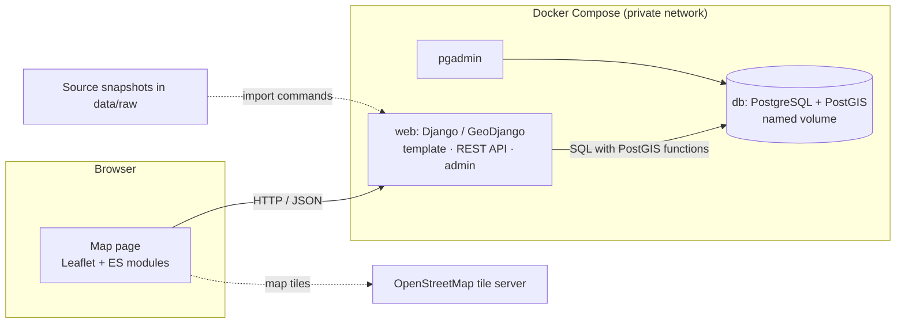

# StudySmart

[](https://github.com/sayoowolabi/studysmart/actions/workflows/tests.yml)

StudySmart helps students find somewhere to study in Dublin. It shows public libraries and cafés on an interactive map, finds the nearest ones to a university campus, the user's location or a point on the map, and filters them by facilities that the source data actually confirms.

It is an individual project for the Advanced Web Mapping / Location-Based Services module. Its objectives are to demonstrate a spatial database (PostgreSQL/PostGIS), a Django/GeoDjango REST API with spatial queries, an interactive Leaflet frontend, a reproducible Docker deployment, and sound software engineering practice: automated tests, continuous integration and documentation.

## Contents

- [Features](#features)
- [Screenshots](#screenshots)
- [Technology stack](#technology-stack)
- [Architecture](#architecture)
- [Repository structure](#repository-structure)
- [Quick start](#quick-start)
- [Environment variables](#environment-variables)
- [Tests and continuous integration](#tests-and-continuous-integration)
- [API](#api)
- [Data sources and licences](#data-sources-and-licences)
- [Known limitations and future improvements](#known-limitations-and-future-improvements)
- [Troubleshooting](#troubleshooting)
- [Deployment beyond local development](#deployment-beyond-local-development)
- [Development process](#development-process)
- [Attribution](#attribution)

## Features

**Map and search**

- Interactive Leaflet map of **24 libraries** (Dublin City Council open data) and **633 cafés** (OpenStreetMap) in the Dublin City Council area. Libraries and cafés have different marker shapes and colours.
- Three ways to choose a starting point: a **university campus** (eight campuses, coordinates taken from OpenStreetMap), **"Use my location"** (browser geolocation) or **"Pick on map"** (tap a point or a study-space marker).
- Automatic search: the **10 nearest matches** appear as numbered result cards linked to numbered map markers. Clicking a card or a marker highlights both. The summary states the total, for example "Showing 10 of 250 nearby study spaces (within 1.0 km)".
- Filters: distance (500 m – 5 km), type (libraries, cafés) and **confirmed facilities** (indoor seating, Wi-Fi, power outlets). A facility that no record confirms is shown disabled.
- Fallbacks when nothing is within the radius: *Search a wider area* and *Show nearest match*.
- Popups with address, distance and all five facilities as Yes / No / **Unknown**, plus source and licence.
- Optional administrative-area boundary overlay and a table of **library and café counts per area**.
- Responsive layout (desktop, tablet, phone), keyboard-accessible controls, loading, empty and error states, and clear geolocation error messages.

**Spatial operations (PostGIS, via GeoDjango)**

- Radius search (`ST_DistanceSphere`), nearest neighbour (distance order with `LIMIT 1`) and area containment with counts (`ST_CoveredBy`). The browser never calculates distances or containment.

**Data management**

- REST API with public read access and permission-controlled create, update and delete.
- Django admin with map widgets. Administrators can correct facilities with evidence notes; corrections are protected from later imports.
- Repeatable, idempotent imports from source snapshots committed to the repository.

**Data honesty**

- Facilities are `true`, `false` or **unknown**; unknown is never shown or filtered as confirmed. All 24 library records have unknown facilities because the source does not record them. No facility has been surveyed in person, and no demonstration data is included.

## Screenshots

| Desktop | Phone |
| --- | --- |
|  |  |

## Technology stack

| Layer | Technology |
| --- | --- |
| Database | PostgreSQL 17 with PostGIS 3.6 (`postgis/postgis:17-3.6` image) |
| Backend | Python 3.12, Django 5.2 LTS with GeoDjango, Django REST Framework 3.18, Psycopg 3 |
| Spatial libraries | GDAL, GEOS and PROJ (inside the Django container) |
| Frontend | Django template, Leaflet 1.9.4, OpenStreetMap tiles, Bootstrap 5.3 (CSS), native JavaScript ES modules (no build step), self-hosted Nunito font |
| Deployment | Docker Compose: Django, PostGIS and pgAdmin 4 services on a private network with named volumes |
| Quality | Django test runner against PostGIS, browser tests (Node 22 and headless Chrome/Edge, no npm packages), GitHub Actions |

Exact dependency versions are pinned in [requirements.txt](requirements.txt), [docker-compose.yml](docker-compose.yml), [Dockerfile](Dockerfile) and the template's CDN links (with Subresource Integrity hashes).

## Architecture



The browser asks the REST API for study spaces; Django turns each search into one PostGIS query; results return as JSON and are drawn on the map. Details, a request sequence diagram and the main design decisions are in **[docs/architecture.md](docs/architecture.md)**. The database schema, geometry and import process are in **[docs/database.md](docs/database.md)**.

## Repository structure

```text
studysmart/              Django project: settings and root URLs
spaces/                  Django app
  models.py              StudySpace and AdministrativeArea (PostGIS geometry)
  serializers.py         API representation and validation
  views.py               Map page, REST API views and filters
  spatial.py             All spatial queries (radius, nearest, containment, GeoJSON)
  universities.py        Campus starting points (OpenStreetMap-sourced)
  validators.py          Geometry validation shared by API, admin and imports
  admin.py               Django admin with map widgets
  importers/, management/commands/   Snapshot import commands
  templates/, static/    Map page, JavaScript modules, CSS and font
  tests/                 Django tests and synthetic import fixtures
data/                    Source snapshots, checksums manifest and stable identity maps
frontend-tests/          Browser tests for the map page
docs/                    Architecture, database, API, testing, deployment and data-source documentation
.github/workflows/       Continuous integration
Dockerfile, docker-compose.yml, .env.example, requirements.txt
```

## Quick start

Verified from a fresh clone on 2026-10-30 (see [docs/deployment.md](docs/deployment.md#clean-installation-verification)).

**Prerequisites:** Git; Docker Desktop (Linux containers; WSL 2 backend on Windows) or Docker Engine with Compose v2; free host ports 8000 and 5050; internet access for the first build. No local Python installation is needed. Commands are shown for PowerShell; they also work in Bash except `Copy-Item` (use `cp`).

1. **Clone and configure**

   ```powershell
   git clone https://github.com/sayoowolabi/studysmart.git
   cd studysmart
   Copy-Item .env.example .env
   ```

   Edit `.env` and replace the three `change-me` values with your own long random secrets (see [Environment variables](#environment-variables)). Django refuses to start with missing or placeholder secrets.

2. **Build, start the database and create the tables**

   ```powershell
   docker compose build web
   docker compose up -d db pgadmin
   docker compose run --rm web /usr/local/bin/python manage.py migrate
   docker compose up -d web
   ```

   The database health check makes the other services wait until PostgreSQL is ready. The first build takes a few minutes.

3. **Import the data** (areas first; locations are checked against them)

   ```powershell
   docker compose exec web /usr/local/bin/python manage.py import_administrative_areas --repair-invalid
   docker compose exec web /usr/local/bin/python manage.py import_libraries
   docker compose exec web /usr/local/bin/python manage.py import_cafes
   ```

   Expected: 5 areas, 24 libraries and 633 cafés created. Running the commands again reports everything `unchanged`. Add `--dry-run` to preview an import without saving.

4. **Open the application**

   | Service | Address |
   | --- | --- |
   | StudySmart map | [http://localhost:8000/](http://localhost:8000/) |
   | REST API (browsable) | [http://localhost:8000/api/](http://localhost:8000/api/) |
   | Django admin | [http://localhost:8000/admin/](http://localhost:8000/admin/) |
   | pgAdmin | [http://localhost:5050/](http://localhost:5050/) |

5. **Optional: create an administrator** (needed for admin and API writes)

   ```powershell
   docker compose exec web /usr/local/bin/python manage.py createsuperuser
   ```

   To browse the database in pgAdmin, log in with your `PGADMIN_DEFAULT_*` values and register a server with host `db`, port `5432` and your `POSTGRES_*` database, user and password.

**Stopping and restarting:** `docker compose stop` / `docker compose start`, or `docker compose down` / `docker compose up -d` to recreate the containers. Data lives in the named volume `studysmart_postgres_data` and survives both. **Never add `-v`** to `docker compose down` unless you intend to delete the database.

## Environment variables

Compose passes these from `.env` to the services; Django reads them from its environment. `.env` is ignored by Git and excluded from the Docker image. `.env.example` contains placeholders only.

| Variable | Purpose |
| --- | --- |
| `DJANGO_SECRET_KEY` | Long random Django signing secret (required) |
| `DJANGO_DEBUG` | `True` or `False`; defaults to `False`. Use `True` locally: the development server serves the app's own JavaScript and CSS only in debug mode |
| `DJANGO_ALLOWED_HOSTS` | Comma-separated host names; defaults to `localhost,127.0.0.1,[::1]` |
| `POSTGRES_DB`, `POSTGRES_USER`, `POSTGRES_PASSWORD` | Database name and account, created when the volume is first initialised |
| `PGADMIN_DEFAULT_EMAIL`, `PGADMIN_DEFAULT_PASSWORD` | pgAdmin login |
| `DOCKER_SUBNET` | Private subnet for the Compose network; defaults to `172.30.50.0/24` |

Generate each secret with a cryptographically secure generator, for example in Bash `openssl rand -hex 48`, or in Windows PowerShell 5.1:

```powershell
$generator = [System.Security.Cryptography.RandomNumberGenerator]::Create()
$secretBytes = New-Object byte[] 48
$generator.GetBytes($secretBytes)
[BitConverter]::ToString($secretBytes).Replace('-', '').ToLowerInvariant()
$generator.Dispose()
```

Single-quote values in `.env` that contain `$` or `#`. Do not share the generated values.

## Tests and continuous integration

| Suite | Size | Command |
| --- | --- | --- |
| Django tests (models, API, permissions, spatial queries, imports, settings, page) against a separate PostGIS test database | 129 tests | `docker compose exec web /usr/local/bin/python manage.py test spaces` |
| Browser tests of the map page (needs Node 22+ and Chrome, Chromium or Edge; the app running with data imported) | 39 checks | `node frontend-tests/map-ui.test.mjs` |
| System and migration checks | | `docker compose exec web /usr/local/bin/python manage.py check` and `… makemigrations --check --dry-run` |

[GitHub Actions](.github/workflows/tests.yml) runs all of these on every push and pull request, using this repository's own `Dockerfile` and `docker-compose.yml` with throwaway test credentials. What each test covers, the verified results and how intermittent failures were diagnosed are in **[docs/testing.md](docs/testing.md)**.

## API

| Method | URL | Purpose | Access |
| --- | --- | --- | --- |
| GET | `/api/spaces/` | List study spaces, with `type` and facility filters | Public |
| GET | `/api/spaces/{id}/` | One study space | Public |
| POST | `/api/spaces/` | Create a study space | `add_studyspace` permission |
| PATCH | `/api/spaces/{id}/` | Update a study space | `change_studyspace` permission |
| DELETE | `/api/spaces/{id}/` | Delete a manually created study space | `delete_studyspace` permission |
| GET | `/api/spaces/nearby/?lat=&lng=&radius=` | Spaces within a radius, nearest first, with `distance_m` | Public |
| GET | `/api/spaces/nearest/?lat=&lng=` | The single nearest matching space | Public |
| GET | `/api/areas/` | Administrative-area boundaries as GeoJSON | Public |
| GET | `/api/areas/coverage/` | Library and café counts per area | Public |

Parameters, example requests and responses, validation rules and every error status are documented in **[docs/api.md](docs/api.md)**.

## Data sources and licences

| Data | Source | Licence |
| --- | --- | --- |
| Libraries | Dublin City Council, [Libraries DCC](https://data.smartdublin.ie/dataset/dublin-city-libraries) (Smart Dublin) | CC BY |
| Administrative areas | Dublin City Council, [Administrative Areas DCC](https://data.smartdublin.ie/dataset/administrative-areas-dcc) | CC BY |
| Cafés | © OpenStreetMap contributors, via the Overpass API | ODbL 1.0 |
| Campus starting points | © OpenStreetMap contributors (element IDs recorded in `spaces/universities.py`) | ODbL 1.0 |
| Map tiles | © OpenStreetMap contributors, OpenStreetMap tile server | Attribution required; [tile usage policy](https://operations.osmfoundation.org/policies/tiles/) |
| Nunito font | The Nunito Project Authors (`spaces/static/spaces/fonts/OFL.txt`) | SIL Open Font License 1.1 |

The exact snapshots used are committed in `data/raw/` with SHA-256 checksums, retrieval times and licences in `data/source-manifest.json`. Source choices, facility-tag mapping, identity handling and data-quality limitations are documented in **[docs/data-sources.md](docs/data-sources.md)**.

## Known limitations and future improvements

**Data**

- Facility data is sparse and source-reported: of 633 cafés, 91 confirm indoor seating, 29 Wi-Fi and 1 power outlets; all library facilities are unknown. Seating values are not live availability.
- Coverage is the Dublin City Council area only. UCD Belfield is outside it, so the app shows a coverage note for that campus.
- Records reflect the committed snapshots (libraries list reviewed 2021, OpenStreetMap retrieved October 2026), not a live feed. Some café positions are approximate centres of buildings (`location_method = osm_center`).
- There is no "quiet environment" information in any source, so there is no such filter.

**Application**

- Facility counts on the filters reflect the moment the page loaded.
- Choosing an arbitrary map point needs a pointer or touch; keyboard users can choose a campus, their location or a marker.
- Geolocation needs a secure origin, so it works on `localhost` but not when the development server is opened from another device over plain HTTP.
- The API is not paginated (657 records) and has no rate limiting.
- The local setup uses Django's development server over HTTP; see [Deployment beyond local development](#deployment-beyond-local-development).

**Possible improvements:** facility reports from users with moderation; opening hours from OpenStreetMap; wider coverage beyond Dublin City Council; a geography column or projected index for index-assisted radius searches at larger scale; pagination; and a production deployment as outlined in [docs/deployment.md](docs/deployment.md#production-and-cloud-deployment).

## Troubleshooting

| Problem | Solution |
| --- | --- |
| The map page loads but the map is blank and `map.js` returns 404 | Set `DJANGO_DEBUG=True` in `.env` and run `docker compose up -d web` (the development server serves static files only in debug mode). After adding new static files, run `docker compose restart web`. |
| Map tiles show "Access blocked" | The browser is not sending a `Referer` header; the tile layer requests one with `referrerPolicy`. Hard-refresh (Ctrl+F5) to load the current `map.js`. |
| Changes to code are not picked up | Synced folders (OneDrive, Dropbox) can delay file-change events; run `docker compose restart web`. Hard-refresh the browser for JavaScript and CSS. |
| `Set DJANGO_SECRET_KEY …` or a similar error on start | `.env` is missing a value or still has a `change-me` placeholder. |
| Port 8000 or 5050 is in use | Stop the other service, or change the host side of the port mapping. |
| Network subnet overlaps | Set another private range in `DOCKER_SUBNET`, then `docker compose down` and `docker compose up -d` (data is kept). |
| Database password change has no effect | `POSTGRES_*` values are only applied when the volume is first created. |
| Import says areas are missing | Run `import_administrative_areas --repair-invalid` before the library and café imports. |
| Logs | `docker compose logs --tail 50 web db pgadmin` (remove secrets before sharing). |

## Deployment beyond local development

The Compose setup is a **local development environment**: Django's development server, plain HTTP and a PostgreSQL superuser account. Running StudySmart publicly would need a WSGI server (for example Gunicorn), collected static files, HTTPS with secure cookies and HSTS, `DJANGO_DEBUG=False`, a restricted database role, managed secrets and backups. `manage.py check --deploy` reports exactly the HTTPS-related settings to enable. A step-by-step outline for a cloud host with managed PostGIS is in **[docs/deployment.md](docs/deployment.md#production-and-cloud-deployment)**, together with the security review, the clean-install procedure and the persistence check.

## Development process

The work was planned as GitHub Issues and delivered one issue per feature branch, merged into `main` through pull requests:

| Issue | Delivered |
| --- | --- |
| #1 Django and Docker environment | Compose services, PostGIS connection, environment-based secrets |
| #2 PostGIS models and data import | Models, migrations, spatial indexes, repeatable imports |
| #3 CRUD REST API | Serializers, permissions, validation, filters |
| #4 Spatial search and area analysis | Radius, nearest and containment queries |
| #5 Interactive Leaflet map | Map page, popups, boundary overlay |
| #6 Search and filter interface | Searches, filters, facility handling |
| #7 Testing and security | Test coverage gaps, security review |
| #15 Frontend redesign | Three-step search flow, result cards, responsive layout |
| #8 Documentation and final verification | This documentation and the final checks |

Continuous integration, a verified clean installation and the engineering decisions are recorded in [docs/testing.md](docs/testing.md), [docs/deployment.md](docs/deployment.md) and [docs/architecture.md](docs/architecture.md#design-decisions). Project conventions for contributors are in [AGENTS.md](AGENTS.md).

## Attribution

Library and area data © Dublin City Council (CC BY). Café and campus data © OpenStreetMap contributors (ODbL). Map tiles © OpenStreetMap contributors. Leaflet, Bootstrap and Django are used under their respective open-source licences. Nunito is used under the SIL Open Font License.

AI assistance was used for the initial documentation, Issues #1–8 and the Issue #15 redesign. The student must review, verify and understand the work, and document assistance according to the module policy.
