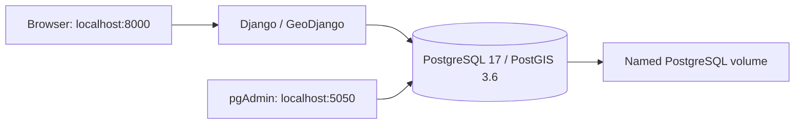

# StudySmart

StudySmart is an individual Advanced Web Mapping / Location-Based Services university project to help students find study spaces in Dublin.

## Current scope

Issue #1 provides a Django project (`studysmart`), an app (`spaces`), a simple page at `/`, and a Docker development environment with PostGIS and pgAdmin4.

Issue #2 adds a shared `StudySpace` model for libraries and cafés, five nullable facility fields, administrative-area multipolygons, repeatable snapshot imports and Django-admin editing. Source metadata, retrieval times, licences and original attributes are preserved. Unknown facilities remain SQL NULL.

Issue #3 adds a study-space CRUD REST API at `/api/spaces/` with public read access, model-permission-controlled writes and type/facility filters.

Issue #4 adds PostGIS-backed nearby and nearest searches and per-area library/café counts.

Issue #5 replaces the development home page with an interactive Leaflet map of all libraries and cafés, loaded from the REST API, and adds a read-only `/api/areas/` GeoJSON endpoint for an optional boundary overlay.

Issue #6 adds a search and filter sidebar to the map: radius and nearest searches from a clicked location, type and confirmed-facility filters, and per-area counts. It uses the existing Issue #3–5 endpoints without backend changes.

StudySmart covers two categories only: libraries and cafés. University study spaces, mentioned in an early Issue #5 task, are out of scope; the model and migrations are unchanged.

## Architecture



All three services share a dedicated bridge network with an explicit private subnet. Docker DNS resolves the database as `db`; container addresses are not hard-coded. Only the Django and pgAdmin ports are published, both on the host loopback interface. PostgreSQL has no host port.

Dependencies are Django 5.2 LTS (which includes GeoDjango), Django REST Framework and Psycopg 3. Python 3.12 and GEOS/GDAL/PROJ run inside the Django container. Compose passes environment variables to Django, so no dotenv package is required. Django's development server is used; this is not a production deployment.

## Prerequisites

- Docker Desktop running **Linux containers**, with its WSL 2 backend recommended on Windows.
- Docker Compose supporting health-based dependencies.
- Internet access for the initial image and package downloads.
- Available host ports 8000 and 5050.
- A private subnet that does not overlap your local, VPN or other Docker networks.

A host Python installation is not required for the commands below. Run them from the repository root in PowerShell or the PyCharm terminal.

## Environment configuration

For a new checkout only:

```powershell
Copy-Item .env.example .env
```

Do not overwrite an existing `.env`. Replace the `change-me` values with unique local secrets before starting. Settings reject missing secrets and the provided placeholders.

| Variable | Purpose |
| --- | --- |
| `DJANGO_SECRET_KEY` | Long random Django signing secret |
| `DJANGO_DEBUG` | Exactly `True` or `False`; defaults to false if absent |
| `DJANGO_ALLOWED_HOSTS` | Comma-separated hostnames; local defaults exclude wildcards |
| `POSTGRES_DB` | Database created on first initialisation |
| `POSTGRES_USER` | Local development database account |
| `POSTGRES_PASSWORD` | Unique database password |
| `PGADMIN_DEFAULT_EMAIL` | pgAdmin login email |
| `PGADMIN_DEFAULT_PASSWORD` | Separate pgAdmin password |
| `DOCKER_SUBNET` | Dedicated subnet; defaults to `172.30.50.0/24` |

A PowerShell 5.1-compatible way to generate one random secret is:

```powershell
$generator = [System.Security.Cryptography.RandomNumberGenerator]::Create()
$secretBytes = New-Object byte[] 48
$generator.GetBytes($secretBytes)
[BitConverter]::ToString($secretBytes).Replace('-', '').ToLowerInvariant()
$generator.Dispose()
```

Repeat for each secret and enter the values locally. Do not share the output. Single-quoted values in `.env` preserve literal `$` and `#` characters.

`.env` is ignored by Git and excluded from Docker's build context. `.env.example` contains placeholders only. Compose explicitly passes only the environment variables each service needs. Django does not load `.env` directly.

## Start the environment

```powershell
docker compose config --quiet
docker compose build web
docker compose up -d db pgadmin
docker compose run --rm web /usr/local/bin/python manage.py migrate
docker compose up -d web
docker compose ps
```

The database health check waits for PostgreSQL to accept TCP connections. Both dependent services wait for that health check. Migrations remain an explicit command, rather than running on every web-server restart.

Open:

- Django: [http://localhost:8000/](http://localhost:8000/)
- Django admin: [http://localhost:8000/admin/](http://localhost:8000/admin/)
- pgAdmin: [http://localhost:5050/](http://localhost:5050/)

The first image build and pgAdmin initialisation can take several minutes. A running container may not yet be serving HTTP; inspect its logs and retry the page once initialisation completes.

Optionally create a Django administrator interactively:

```powershell
docker compose exec web /usr/local/bin/python manage.py createsuperuser
```

Django administrator credentials are separate from pgAdmin and database credentials.

In pgAdmin, log in using your local `PGADMIN_DEFAULT_*` values, then register a server:

| Field | Value |
| --- | --- |
| Name | StudySmart |
| Host name/address | `db` |
| Port | `5432` |
| Maintenance database | Your `POSTGRES_DB` value |
| Username/password | Your `POSTGRES_USER` and `POSTGRES_PASSWORD` values |

Inside pgAdmin's container, `localhost` means pgAdmin itself, not PostgreSQL.

## Checks and tests

```powershell
docker compose exec web /usr/local/bin/python manage.py check --database default
docker compose exec web /usr/local/bin/python -m pip check
docker compose exec web /usr/local/bin/python manage.py showmigrations
docker compose exec web /usr/local/bin/python manage.py test spaces
(Invoke-WebRequest -UseBasicParsing http://localhost:8000/).StatusCode
```

Tests cover:

- environment checks
- models and tri-state facility parsing
- seated-café selection
- admin permissions and corrections
- repeat imports and geometry validation/transformation
- the CRUD API (permissions, validation, filters, imported-record protection)
- spatial searches using known geometries
- the boundary GeoJSON endpoint and the map page (API URLs, static assets, pinned CDN hashes, attribution)
- the search interface (filter controls match API parameters, labelled controls, no HTML insertion, combined facility filters)
- the Issue #7 additions: updates, read-only provenance fields, per-operation permissions, anonymous write attempts on every endpoint, HTTP errors, exact polygon containment, host and security-header configuration (see the Issue #7 section)

Database tests create a separate test database and remove it afterwards; they do not delete the application database. Import tests use clearly fictional fixtures and make no network calls.

To verify the actual application database through Django:

```powershell
@'
from django.db import connection
with connection.cursor() as cursor:
    cursor.execute("SELECT current_database(), PostGIS_Version()")
    print(cursor.fetchone())
'@ | docker compose exec -T web /usr/local/bin/python manage.py shell
```

The PowerShell here-string avoids nested command-line quoting. You can also enter these statements in an interactive `manage.py shell`.

## Stop, restart and verify persistence

Temporarily stop/start the existing containers:

```powershell
docker compose stop
docker compose start
```

Stop and remove this project's containers and network, retaining the named volumes:

```powershell
docker compose down
docker compose up -d
```

Never add `-v` when retaining database data. PostgreSQL uses `studysmart_postgres_data`; pgAdmin configuration uses `studysmart_pgadmin_data`. Database files are mounted at `/var/lib/postgresql/data` for the selected PostgreSQL 17 image.

To manually verify persistence:

1. Create a Django administrator and confirm login works.
2. Run `docker compose restart`; confirm login still works.
3. Run `docker compose down`, then `docker compose up -d`.
4. Confirm the same login still works and `showmigrations` still lists applied migrations.

Named volumes survive container recreation, but are not backups.

## PyCharm and Docker Desktop

Open the repository in PyCharm and use its terminal for the Compose commands. In editions supporting Docker Compose interpreters, select service `web` and interpreter `/usr/local/bin/python`. Otherwise, keep running management commands in the terminal; installing Windows GDAL libraries is unnecessary.

In Docker Desktop, expand the `studysmart` project to see `web`, `db` and `pgadmin`. Check service logs, database health, published ports and the two named volumes. Use `docker network inspect studysmart_studysmart_network` to verify the configured subnet and membership.

## Troubleshooting and limitations

- **OneDrive:** this checkout is inside OneDrive. Source bind mounts can be slower and reload notifications may be unreliable. If edits are not detected, run `docker compose restart web`. Keep database files in Docker named volumes, not a OneDrive bind mount.
- **Subnet collision:** choose another unused private CIDR in `DOCKER_SUBNET`. If this project's network already exists, recreate its containers/network with `docker compose down` and `docker compose up -d`, retaining volumes.
- **Port collision:** stop the conflicting local service or edit the host-side port mapping. Do not stop unrelated containers without checking.
- **Database credentials:** initialisation variables apply only to an empty database volume. Editing a password in `.env` does not change an existing database role's password.
- **Development permissions:** Django uses the image's bootstrap PostgreSQL account, which is a superuser. Use a separate restricted application role before deploying beyond local development.
- **Secrets:** ignored environment files are local plaintext, not encrypted storage. Docker administrators can inspect container environments. Do not share resolved Compose configuration or commit credentials.
- **Deployment:** local HTTP, optional debug output and `runserver` are for development. Production needs a deployment server, HTTPS, restricted database roles and a security review.
- **Network isolation:** the dedicated bridge separates this stack from unrelated Compose networks; it is not an air gap and permits outbound traffic.
- **Image versions:** database and Python tags are versioned but not digest-locked. Do not change PostgreSQL major versions against an existing data volume without a migration/backup plan.
- **Logs:** use `docker compose logs --tail 50 web db pgadmin` locally, and redact sensitive information before sharing.

## Issue #1 verification

Verified locally with Docker Desktop's Linux engine and Docker Compose:

| Check | Result |
| --- | --- |
| Compose configuration and Django image build | Passed |
| Built-in Django migrations | All 18 applied |
| Django system check with the default database | No issues |
| Python dependency check | No broken requirements |
| Django tests | All 9 passed, including a live PostGIS query |
| Django connection to application database | Connected to `studysmart`; PostGIS 3.6 available |
| HTTP smoke checks | Django home page and pgAdmin login returned 200 |
| Network and volume inspection | Explicit `172.30.50.0/24` bridge; named PostgreSQL volume mounted |
| pgAdmin network connectivity | Resolved `db` and reached TCP port 5432 |
| Persistence after restart and container recreation | All 18 migration records, including timestamps, retained the same checksum; migrations were not rerun |
| Secret handling | `.env` ignored and untracked; absent from the built image |
| Image runtime user | Unprivileged `django` user |

Initial HTTP probes failed while services were still initialising; subsequent probes passed. Interactive pgAdmin server registration and the PyCharm GUI have not been verified automatically. PyCharm's SDK helper could not resolve the project module during verification; all application checks used the explicitly selected interpreter inside Docker.

## Import study-space data (Issue #2)

Read [data sources and import decisions](docs/data-sources.md) for the schema, exact datasets, licences, download instructions, stable identity mappings and known data-quality limitations. The exact source snapshots used for the recorded imports are committed in `data/raw/`, with their checksums, licences and retrieval times in `data/source-manifest.json`. A fresh clone can therefore reproduce the same import without downloading anything. Git stores these files byte-for-byte (`.gitattributes`), so their checksums match on every platform.

To import:

```powershell
docker compose exec web /usr/local/bin/python manage.py migrate
docker compose exec web /usr/local/bin/python manage.py import_administrative_areas --repair-invalid --dry-run
docker compose exec web /usr/local/bin/python manage.py import_administrative_areas --repair-invalid
docker compose exec web /usr/local/bin/python manage.py import_libraries
docker compose exec web /usr/local/bin/python manage.py import_cafes
```

The two invalid source boundaries require the explicit repair flag; repair methods and original validity reasons are recorded. Location imports require the complete area set. Commands accept `--manifest PATH` and `--dry-run`, validate snapshot hashes, report invalid/outside records and never delete missing source records. Reimporting an unchanged snapshot creates no duplicates.

In Django admin, use the category and indoor-seating filters to select cafés with confirmed indoor seats. Unknown-seat cafés remain stored. Editing any facility automatically protects all five facility values from imports and requires evidence notes; source metadata remains read-only. For imported records, name, type, location, address and description are also read-only, matching the API, because the next import would overwrite them. Uncheck the facility lock in a separate save to resume source-owned facility updates.

## Issue #2 verification

Verified locally against PostGIS after applying `spaces.0001_initial`:

| Check | Result |
| --- | --- |
| Django checks and migration consistency | No issues; no unrecorded model changes |
| Automated tests | All 54 passed, including the original 9 environment tests |
| DCC libraries | 24 library/service source records; all five facility attributes unknown |
| OSM cafés | 633 named records inside DCC; 408 outside the study area and 49 unnamed records reported/excluded from the 1,090-element snapshot |
| Café indoor seating | 91 true, 3 false, 539 unknown; the indoor-seat filter selects only the 91 true records |
| Café outdoor seating | 123 true, 90 false, 420 unknown |
| Café Wi-Fi | 29 true, 10 false, 594 unknown |
| Café outlets and laptop permission | Both unknown for all 633 imported cafés |
| Administrative areas | Five valid 2D EPSG:4326 multipolygons; two explicit source repairs recorded |
| Spatial indexes | GiST indexes confirmed for points and boundaries |
| Repeated real imports | Zero creations/updates; all study-space primary keys, source IDs and import timestamps preserved |

These counts describe the recorded snapshots, not live coverage or independently verified venue facilities. The first real boundary import exposed Z ordinates and source self-intersections; handling and tests were updated before the final successful run. A preliminary admin-form test failed because it requested an unlock while expecting protected-field validation; the corrected test and final suite passed.

## Study-space REST API (Issue #3)

| Method | Endpoint | Access | Success |
| --- | --- | --- | --- |
| GET | `/api/spaces/` | Public | 200, JSON list |
| GET | `/api/spaces/{id}/` | Public | 200 |
| POST | `/api/spaces/` | `spaces.add_studyspace` permission | 201 |
| PATCH | `/api/spaces/{id}/` | `spaces.change_studyspace` permission | 200 |
| DELETE | `/api/spaces/{id}/` | `spaces.delete_studyspace` permission | 204 |

PUT is not offered (405); use PATCH. Superusers hold all three permissions. Authentication uses the Django session from logging in at `/admin/`, so writes also need a CSRF token; the browsable API at `/api/spaces/` handles this automatically. HTTP Basic authentication is disabled because this development server uses plain HTTP.

### Fields

Requests and responses use `latitude`/`longitude` in EPSG:4326 degrees; the server stores them as a PostGIS `Point(longitude, latitude)`.

| Field | Write rules |
| --- | --- |
| `name`, `space_type` (`library`/`cafe`), `latitude` (−90..90), `longitude` (−180..180) | Required on create |
| `address`, `description` | Optional text |
| `indoor_seating`, `outdoor_seating`, `has_wifi`, `has_outlets`, `laptop_allowed` | `true`, `false` or `null` (unknown, the default) |
| `facility_verification_notes` | Required whenever a facility value is set or changed |
| `id`, `location_method`, `facility_import_locked`, `facility_verified_at`, `source_*`, `imported_at` | Read-only |

Raw `source_attributes` are not exposed. Source URL, licence and kind remain in every record for attribution.

### Filters (list only)

| Parameter | Values |
| --- | --- |
| `type` | `library`, `cafe` |
| `indoor_seating`, `outdoor_seating`, `has_wifi`, `has_outlets`, `laptop_allowed` | `true`, `false`, `unknown` (case-insensitive) |

Filters combine with AND. `true` matches only confirmed values, so `/api/spaces/?type=cafe&indoor_seating=true` excludes cafés with false or unknown seating. `unknown` matches SQL NULL. Any other value returns 400. Results are not paginated and seating values are source-reported, not live occupancy.

### Data-integrity rules

- Setting or changing any facility through the API behaves like the Django admin: all five facility values are protected from future imports, the verification time is recorded and evidence notes are required.
- For imported records (`source_kind` `official` or `osm`), changes to `name`, `space_type`, location, `address` or `description` return 400, because the next import would overwrite them. Correct these in the source data instead.
- Imported records cannot be deleted (409 Conflict), because the next import would recreate them. Manually created records can be edited and deleted normally. API-created records are always `source_kind=manual`.
- Validation reuses the model's own checks (`full_clean()`), including the finite-coordinate validator, so API, admin and import rules match.

### Status codes and errors

| Code | Meaning |
| --- | --- |
| 400 | Validation error, as `{"field": ["message"]}` |
| 403 | Not logged in, missing model permission or missing CSRF token |
| 404 | No study space with that ID |
| 405 | Unsupported method (PUT) |
| 409 | Attempt to delete an imported record |

### Manual check

```powershell
# Public reads (no login)
Invoke-RestMethod "http://localhost:8000/api/spaces/?type=cafe&indoor_seating=true" | Measure-Object
Invoke-WebRequest -UseBasicParsing "http://localhost:8000/api/spaces/?indoor_seating=maybe"   # 400
Invoke-WebRequest -UseBasicParsing -Method Post "http://localhost:8000/api/spaces/" -ContentType "application/json" -Body '{}'   # 403
```

For writes, log in at `/admin/`, open `/api/spaces/` and use the browsable API's form. Then check:

- A record with latitude 91 is rejected.
- A valid record can be created, PATCHed and deleted.
- DELETE on an imported café returns 409.

## Issue #3 verification

| Check | Result |
| --- | --- |
| Django system check and `makemigrations --check` | No issues; no model changes requiring migrations |
| Automated tests | All 70 passed: 54 existing plus 16 API tests |
| Confirmed indoor-seat café filter on imported data | 91 records over HTTP, matching the Issue #2 count |
| Invalid filter value / anonymous POST over HTTP | 400 / 403 |

## Spatial search and area analysis (Issue #4)

All three operations run in PostGIS through GeoDjango. Python never calculates distances or containment. The query functions are in [spaces/spatial.py](spaces/spatial.py). All endpoints are public and read-only.

| Endpoint | Operation | PostGIS function |
| --- | --- | --- |
| `GET /api/spaces/nearby/?lat=&lng=&radius=` | Spaces within `radius` metres, nearest first | `ST_DistanceSphere` |
| `GET /api/spaces/nearest/?lat=&lng=` | Single closest matching space | `ST_DistanceSphere` + `LIMIT 1` |
| `GET /api/areas/coverage/` | Library and café counts per administrative area | `ST_CoveredBy` |

### Parameters and validation

- `lat` (−90..90) and `lng` (−180..180) are required decimal degrees in EPSG:4326 (WGS 84). NaN and infinity are rejected.
- `radius` is required for `nearby`. It is in metres, must be greater than 0 and at most 10,000.
- `nearby` and `nearest` accept the same `type` and facility filters as `/api/spaces/`. For example, `type=cafe&indoor_seating=true` matches only confirmed indoor seating. Filters apply before distance ordering, so `nearest` returns the closest *matching* space.
- Invalid values return `400 {"field": ["message"]}`.

### Responses

`nearby` returns a JSON list in the same format as `/api/spaces/`, plus `distance_m` (metres, one decimal place), ordered by distance. A search with no matches returns `200 []`.

`nearest` returns one study-space object with `distance_m`. If nothing matches, it returns `404 {"detail": "No study space matches these filters."}`.

`coverage` returns one row per area, ordered by name:

```json
[{"id": 1, "source_id": "central", "name": "CENTRAL", "library_count": 7, "cafe_count": 193, "total_count": 200}]
```

If no areas have been imported, `coverage` returns `200 []`.

### Coordinate systems, units and accuracy

- **Shared coordinate system:** stored points, stored boundaries and search points all use EPSG:4326, so no coordinate transformation happens at query time. Boundaries were converted from ITM (EPSG:2157) during the Issue #2 import.
- **Distance units:** for longitude/latitude geometry, GeoDjango's `Distance` uses `ST_DistanceSphere`, which returns metres. The spherical model differs from the more exact spheroid by less than about 0.5%, which is acceptable for walking-distance search.
- **Consistent distances:** one distance annotation is used to filter, sort and report results, so a returned `distance_m` never exceeds the requested radius.
- **Boundary edges:** `ST_CoveredBy` includes points exactly on an edge, so a space on a shared border counts in both areas. Spaces outside every area are not counted.

### Indexes and performance

| Operation | Index use | Measured cost |
| --- | --- | --- |
| Coverage | `ST_CoveredBy` uses the GiST index on `location` (a bitmap index scan in `EXPLAIN`). Each boundary is passed as a subquery, so polygons never leave the database. | 1 + number-of-areas queries (6 for DCC) |
| Nearby / nearest | `ST_DistanceSphere` is not index-assisted, so `EXPLAIN` shows a sequential scan. The distance for every row is computed inside PostgreSQL. | 1 query each |

For 657 rows the sequential scan takes milliseconds, and at this table size the planner would choose it anyway. Index-assisted radius searches would need a geography column or a projected (ITM) expression index. Neither is justified at this data size.

### Manual check

Windows PowerShell 5.1 passes a JSON array down the pipeline as one object, so wrap list requests in parentheses before `Select-Object`. It also decodes UTF-8 names as ISO-8859-1 ("Caffè" instead of "Caffè"). Browsers, JavaScript and PowerShell 7 decode them correctly.

```powershell
(Invoke-RestMethod "http://localhost:8000/api/spaces/nearby/?lat=53.3498&lng=-6.2603&radius=300&type=cafe&indoor_seating=true") | Select-Object name, distance_m
Invoke-RestMethod "http://localhost:8000/api/spaces/nearest/?lat=53.3498&lng=-6.2603&type=library" | Select-Object name, distance_m
Invoke-RestMethod "http://localhost:8000/api/areas/coverage/" | Format-Table
Invoke-WebRequest -UseBasicParsing "http://localhost:8000/api/spaces/nearby/?lat=53.3498&lng=-6.2603&radius=0"   # 400
```

To see the SQL and query plan:

```powershell
docker compose exec web /usr/local/bin/python manage.py shell -c "from spaces.models import StudySpace as S; from spaces.spatial import *; qs = spaces_within(S.objects.all(), search_point(53.3498, -6.2603), 500); print(qs.query); print(qs.explain())"
```

## Issue #4 verification

| Check | Result |
| --- | --- |
| Automated tests | All 84 passed: 70 existing plus 14 spatial tests |
| Known geometry | 0.005° and 0.01° of latitude returned about 556 m and 1,112 m (±1 m); radius 1,100 m excluded and 1,120 m included the 1,112 m point |
| Query counts (`assertNumQueries`) | Nearby 1, nearest 1, coverage 1 + areas |
| Generated SQL | `ST_DistanceSphere` for distance; `EXPLAIN` showed the sequential scan described above |
| Coverage on imported data | Central 200, North Central 52, North West 12, South Central 86, South East 307; total 657, equal to all imported records |
| HTTP smoke checks | Filtered nearby search 200 (12 confirmed-seat cafés within 300 m of the test point); nearest library 200; radius 0 → 400 |

## Interactive map (Issue #5)

Open [http://localhost:8000/](http://localhost:8000/). The page loads every study space from `/api/spaces/` in one request and shows:

- **Libraries** as blue squares marked "L" and **cafés** as orange circles marked "C". Shape and letter differ as well as colour. Libraries are drawn above cafés so they are not hidden in the dense city centre. The legend shows how many of each were loaded.
- A **popup** for each marker with the name, type, address and the five facilities. `true` shows "Yes", `false` "No" and `null` "Unknown"; unknown is never shown as confirmed. Popups state that facilities are source-reported, not live availability, and name the record's source and licence.
- An **Area boundaries** outline layer, off by default, toggled from the layer control (top right). Hovering a boundary shows the area name.
- A **selected search location**: clicking the map places one temporary marker and shows its coordinates; Clear removes it. Issue #6 runs searches from this location.
- **Status messages** while loading, when no study spaces exist, and when either API request fails. A boundary failure does not affect the markers.

### Implementation

| File | Role |
| --- | --- |
| [spaces/templates/spaces/home.html](spaces/templates/spaces/home.html) | Bootstrap layout, map container, legend, selection panel. API URLs come from `` as `data-` attributes, so the JavaScript does not hard-code paths. |
| [spaces/static/spaces/js/](spaces/static/spaces/js/) | Leaflet setup, API requests, markers, popups, boundary overlay and location selection; split into modules in Issue #6 (see below) |
| [spaces/static/spaces/css/map.css](spaces/static/spaces/css/map.css) | Responsive layout, marker and popup styles |

Leaflet 1.9.4 and Bootstrap 5.3.3 (CSS only) load from public CDNs at pinned versions with Subresource Integrity hashes, so the browser refuses a modified file. No build step, API key or paid tile service is used. Base tiles come from the OpenStreetMap tile server, which is suitable for light development use under its [tile usage policy](https://operations.osmfoundation.org/policies/tiles/). That policy requires browsers to send a `Referer` header. Django's default `Referrer-Policy: same-origin` sends none to other sites, so the tile layer alone uses `strict-origin-when-cross-origin`: tile requests carry only the site origin (for example `http://localhost:8000/`), never page paths, and the rest of the site keeps Django's stricter default. Without this, every tile shows "Access blocked".

**Coordinates.** `/api/spaces/` returns plain `latitude`/`longitude` numbers, which are passed to Leaflet as `[latitude, longitude]`. `/api/areas/` returns GeoJSON, whose positions are `[longitude, latitude]`; Leaflet's `L.geoJSON` reads that order itself. Automated tests check both orders.

**Safe display.** Record text (names, addresses, area names) is inserted with `textContent`, never parsed as HTML, so a record created through the API cannot inject markup.

### Boundary endpoint

| Endpoint | Returns |
| --- | --- |
| `GET /api/areas/` | GeoJSON `FeatureCollection`; each feature has the area `id`, a `MultiPolygon` geometry and `properties` `{source_id, name}`, ordered by name |

The endpoint is public and read-only (other methods return 405). PostGIS produces the geometry JSON with `ST_AsGeoJSON` in one query. Coordinates are rounded to five decimal places (about 1 m), which keeps the five DCC boundaries to about 330 KB without altering their shape. With no imported areas it returns an empty `FeatureCollection` and the map offers no overlay.

### Static files and `DEBUG`

Django's development server serves `map.js` and `map.css` only when `DJANGO_DEBUG=True`, which is the value in `.env.example`. With `DEBUG=False` the page loads but the map stays blank because its own script returns 404. After adding a new app `static/` folder, restart the server (`docker compose restart web`), because Django finds app static folders when it starts.

A production deployment would need more than changing `DEBUG`: set `STATIC_ROOT`, run `collectstatic`, serve the collected files from a web server such as Nginx (or WhiteNoise), and keep `DEBUG=False` so error pages do not reveal settings and code. It would also serve the site over HTTPS. This is part of the deployment review in Issues #7–8.

### Manual browser checks

Use a current browser with developer tools open on the Console tab.

1. **Load:** the map opens on Dublin, the legend shows Library (24) and Café (633), and the Console shows no errors.
2. **Interaction:** zoom with the buttons, scroll wheel and pinch; drag to pan; click several markers of each type.
3. **Popup accuracy:** open `/api/spaces/?type=library` in another tab and compare one library's name, address and facilities with its popup. Libraries should show all five facilities as "Unknown". Find a café with confirmed indoor seating (`/api/spaces/?type=cafe&indoor_seating=true`) and check its popup says "Yes".
4. **Coordinates:** confirm markers fall on Dublin streets, not in the sea or elsewhere in the world. Click a known library and compare its map position with its `latitude`/`longitude` in the API.
5. **Boundaries:** tick *Area boundaries* in the layer control; five dashed outlines appear and show their names on hover. Untick to hide them.
6. **Location selection:** click the map; a pin and coordinates appear. Click elsewhere; the pin moves. Click Clear; both disappear.
7. **Responsive:** in device mode, check a phone (390 px), tablet (768 px) and desktop width, and rotate the phone. The map fills the screen below the navbar; the legend and attribution stay readable.
8. **API failure:** run `docker compose stop db` and reload: a red "could not be loaded" message appears and the Console logs the HTTP error. Run `docker compose start db` and reload. DevTools *Offline* mode shows the library-load error instead.
9. **Unsafe text:** log in at `/admin/`, create a manual study space through `/api/spaces/` named ``, and check its popup shows the text literally with no alert. Delete the record afterwards.

## Issue #5 verification

| Check | Result |
| --- | --- |
| Automated tests | All 92 passed, including 4 boundary-endpoint tests and 3 new home-page tests |
| Django system check and `makemigrations --check` | No issues; no model changes |
| HTTP smoke checks | Home page, `map.js`, `map.css`, `/api/areas/` 200; POST `/api/areas/` 405; CDN files and OSM tiles reachable |
| Boundary response on imported data | 5 features, about 327 KB, positions in `[longitude, latitude]` order |
| Headless Edge render at 390 × 844 | 24 library and 633 café markers, legend counts matched, loading message cleared, layer control present, no JavaScript console errors |
| Screenshots at phone and desktop widths | Map fills the viewport; legend, controls and attribution visible |
| SRI hashes | Computed from the downloaded CDN files; they match Leaflet's and Bootstrap's published values |

The first smoke check returned 404 for the new static files until the web server was restarted, as explained above. A test failed once because a code comment contained the word `innerHTML`, which the safe-display test searches for; the comment was reworded. Only step 1 of the manual checks was verified automatically (headless render); steps 2–9 require an interactive browser and are for the student to perform.

## Search and filters (Issue #6)

The sidebar (right on large screens, below the map on tablets and phones) contains:

| Control | Behaviour |
| --- | --- |
| Choose search location | Starts selection mode: a blue frame, crosshair cursor and on-map banner with **Cancel** (Esc also cancels). The next tap on the map sets the search pin there; a tap on a library or café marker sets the pin at that marker's exact position instead of opening its popup. The mode then ends. On tablets and phones the page scrolls the map into view. Outside the mode, map clicks only pan and marker clicks open popups. |
| Search radius | 250 m, 500 m, 1 km (default), 2 km or 5 km. A fixed list, so only values the API accepts (> 0 and ≤ 10,000 m) can be sent. |
| Search within radius | Shows matching spaces within the radius, a circle showing the radius, and a nearest-first results list. Clicking a list item opens that marker's popup. |
| Find nearest | Shows the single closest matching space, highlighted with a yellow ring and a "Nearest · distance" label, and a dashed line from the search pin. |
| Clear location and show all | Removes the pin and returns to showing every matching space. |
| Study-space type | Libraries and Cafés checkboxes. |
| Confirmed facilities | Indoor seating, Wi-Fi, Power outlets. Each sends `<field>=true`, which matches only confirmed values, so unknown is never treated as yes. Each label shows how many records confirm it (see below). |
| Reset filters | Re-ticks both types and clears all facility filters. |
| All Recorded Study Spaces by Area | Library, café and total counts per area from `/api/areas/coverage/`. These are dataset-wide counts: the search location, radius and filters do not change them, and the sidebar says so. |

### Facility filter availability

When the page is rendered, `home()` in [views.py](spaces/views.py) counts the records that **confirm** each facility (value `true`) in one database query. False and unknown values do not count. A facility with 0 confirmed records is shown disabled, labelled "no confirmed records yet", because it could only ever return nothing. Other facilities show their count, for example "Wi-Fi (29 confirmed)".

The filter becomes available automatically on the next page load after a confirmed value exists, whether from an import or a manually verified admin/API edit. No code or configuration change is needed. The API filters themselves are unchanged and always accept every facility. If the count query fails (for example, the database is down), the page still renders with all filters enabled and no counts, and the API error messages appear as before.

**Limitation:** the counts reflect the moment the page loaded. Data imported or edited afterwards appears after a page reload.

### Search and filter flow

The page is always in one of three modes. Every action re-runs the current mode with the current filters, so the same filters always apply to whatever is on the map:

| Mode | Started by | Request |
| --- | --- | --- |
| All | Page load, *Clear location* | `GET /api/spaces/?<filters>` |
| Nearby | *Search within radius* | `GET /api/spaces/nearby/?lat=&lng=&radius=&<filters>` |
| Nearest | *Find nearest* | `GET /api/spaces/nearest/?lat=&lng=&<filters>` |

1. **Filters to parameters.** One function, `filterParams()` in `search.js`, builds the filters for all three modes. One ticked type sends `type=library` or `type=cafe`; both ticked sends no type filter (everything); none ticked sends no request and shows a warning. Each ticked facility adds `<field>=true`. The API combines all parameters with AND.
2. **Re-running.** Changing a filter re-runs the current mode. Changing the radius re-runs a nearby search. Choosing a new location while a nearby or nearest search is shown re-runs that search from the new point.
3. **Server-side spatial work.** Radius filtering, distance ordering and the nearest choice are done by PostGIS (`ST_DistanceSphere`), and the API returns `distance_m`. The browser only formats distances and draws the radius circle and line for display. It never decides which spaces are inside the radius.
4. **Rapid repeated searches.** Every search request cancels the previous one with an `AbortController`. An older, slower response therefore cannot overwrite a newer search. Cancelled requests are ignored silently.
5. **Results.** Markers are replaced, the legend counts update to the markers shown, the sidebar shows a summary and, for searches, a list of up to 50 results with distances.

### States and messages

- **Loading:** "Loading study spaces…", "Searching nearby…" or "Finding the nearest study space…" over the map and in the sidebar.
- **Empty:** for example "No study spaces match these filters within 1.0 km. Try a larger radius." When a facility filter is on, the message adds "Facility filters only include confirmed values." A nearest search with no match (`404`) is treated as an empty result, not an error.
- **Error:** "Study spaces could not be loaded. Please try again." The error is logged to the console. The next successful search clears the message.
- **No type selected:** "Select at least one study-space type."
- Area statistics and boundaries load separately, so their failure never blocks searching.

### JavaScript modules

The JavaScript uses native ES modules (`<script type="module">`), so there is no build step or extra dependency.

| Module | Responsibility |
| --- | --- |
| [map.js](spaces/static/spaces/js/map.js) | Entry point: creates the map and tile layer, starts the other modules |
| [api.js](spaces/static/spaces/js/api.js) | `fetchJson` and HTTP error handling |
| [search.js](spaces/static/spaces/js/search.js) | Sidebar state, location selection mode, filters, the three modes, cancelling superseded requests, results list |
| [markers.js](spaces/static/spaces/js/markers.js) | Marker icons, highlighting, popups, distance formatting. Each marker has one click/Enter handler that asks `search.js` first (selection mode) and otherwise opens the popup. |
| [areas.js](spaces/static/spaces/js/areas.js) | Boundary overlay and the per-area statistics table |
| [status.js](spaces/static/spaces/js/status.js) | Loading, empty and error messages over the map |

All API text is inserted with `textContent` or as DOM elements, never as HTML strings. A test checks that no module uses `innerHTML`, `outerHTML`, `insertAdjacentHTML` or `document.write`.

### Data limitations

- **Library facilities are unknown.** The DCC library CSV has no facility columns. Its description "free access to computers and the internet" does not establish Wi-Fi, outlets or laptop use (see [data-sources.md](docs/data-sources.md)), so all five facilities stay unknown rather than being guessed. Libraries appear in every search without a facility filter. A facility filter hides them, and the sidebar says why. Facilities can be added honestly only through manual verification: an admin edit or API PATCH with evidence notes, which also locks the values against reimport.
- **Café facilities are sparse.** Among the 633 cafés, indoor seating is confirmed for 91 and Wi-Fi for 29. Power outlets: see the next point.
- **Power outlets.** One café (Filo, OSM `way/970119309`) has `socket:bs1363=yes`. `bs1363` is OSM's key for the Irish/UK type G domestic socket, and OSM documents `socket:*` for "anywhere that electric power is supplied for the public or customers". The tag is on the café itself, not a separate charging point. Earlier imports ignored this socket key; the mapping now recognises it. `import_cafes --dry-run` reports exactly one update: Filo's `has_outlets` changes from unknown to true. Until the café import is re-run, no record confirms outlets and the filter is disabled; afterwards it shows "(1 confirmed)" automatically.
- **Ambiguous OSM values stay unknown:** `indoor_seating=bar_table` (1 café) and `internet_access=yes` (16 cafés) do not explicitly confirm indoor seating or Wi-Fi.
- **Quiet environment** has no source data or model field, so there is no filter for it; it is out of scope.
- **University study spaces** are out of scope (see Current scope).
- Area counts include all recorded spaces regardless of filters. Spaces outside every area are not counted.
- Seating values are source-reported, not live occupancy.
- Choosing a location by arbitrary map point needs a pointer or touch. Keyboard users can choose a marker's position: Tab to it and press Enter in selection mode.

### Manual browser checks (Issue #6)

1. **Initial state:** results say "Showing all 657 matching study spaces"; the area table shows five areas totalling 657. *Search within radius* and *Find nearest* are disabled.
2. **Nearby:** click *Choose search location*, tap the map near the centre, choose 1 km, click *Search within radius*. A circle appears; the results list is nearest first; compare the count with `/api/spaces/nearby/?lat=…&lng=…&radius=1000` using the coordinates shown.
3. **Radius:** change to 250 m; the search re-runs and the circle shrinks.
4. **Combined filters:** untick Libraries, tick Indoor seating and Wi-Fi. Only cafés confirming both remain. Open a popup: both say "Yes".
5. **Facility availability:** before re-running the café import, Power outlets is disabled with "no confirmed records yet". After `import_cafes`, reload: it shows "(1 confirmed)" and ticking it shows Filo when the search area includes it. With Indoor seating and Wi-Fi both ticked and no match, the warning explains that facility filters include only confirmed values.
6. **Reset:** click *Reset filters*; both types are ticked, facilities cleared, and the earlier result count returns.
7. **Nearest:** click *Find nearest*. One highlighted marker with a "Nearest · distance" label and a dashed line to the pin; the sidebar names it with the same distance. Untick Cafés: the nearest library is shown instead.
8. **No type:** untick both types; a warning appears and no markers are shown.
9. **Rapid clicks:** click *Find nearest* and *Search within radius* alternately several times quickly. The final display matches the last button pressed. In DevTools → Network, earlier requests show as cancelled.
10. **API failure:** with a nearby search shown, run `docker compose stop db`, then change a filter: a red error appears. Run `docker compose start db` and change a filter again: results return and the error clears.
11. **Responsive:** at desktop width the sidebar is on the right and scrolls on its own. At tablet (768 px) and phone (390 px) widths it appears below the map, and the page scrolls. All controls are reachable with the Tab key, and the checkboxes and radius are labelled.
12. **Area statistics:** the heading reads "All Recorded Study Spaces by Area". Compare the table with `/api/areas/coverage/`, then change filters and run a search: the numbers do not change.
13. **Selection mode:**
    - Without pressing *Choose search location*, tap the map: nothing is selected. Tap a marker: its popup opens.
    - Press *Choose search location*: a blue frame and banner appear. Press *Cancel*: they disappear. Repeat with Esc.
    - Press it again and tap a café marker: no popup opens, the pin appears on the café, and the mode ends. *Find nearest* then shows that café at 0 m.
    - On a phone width, scroll down to the sidebar and press the button: the page scrolls back to the map.

## Issue #6 verification

| Check | Result |
| --- | --- |
| Automated tests | All 96 passed: 92 existing plus 4 new. The new tests check that filter controls match API parameters, that every control has a label, that no module inserts HTML, and that combined facility filters require every facility confirmed (nearby and nearest). |
| Django system check | No issues; no model, serializer or migration changes |
| JavaScript | `node --check` passes for all six modules; every import matches an export |
| Scripted headless Edge test (25 checks, against the running app and imported data) | All passed: initial 657 markers; area table matches the coverage API; nearby (105 at 1 km) and 250 m counts equal the API; combined filters equal the API; outlets empty-state message; reset; nearest name, distance, highlight and label, with pin and result both on screen; nearest respects type; no-type warning; 8 rapid requests, 7 cancelled, last mode displayed; new location re-runs search; simulated HTTP 500 shows an error and recovers; clear location restores all; no unexpected console errors |
| Screenshots at 1366 × 900 and 390 × 844 | Sidebar on the right on desktop and below the map on phone; highlighted nearest result, label, line and pin all visible |

The scripted test lives outside the repository and is not part of the test suite. Two of its first-run failures were test problems (a click landing on a marker, and too short a wait for a slow response), not application faults; the network log confirmed superseded requests were cancelled. The screenshots showed one real issue: opening the nearest result's popup automatically panned the map and could push the search pin off screen, so a permanent distance label replaced the automatic popup. Manual checks 2 and 11 (keyboard and real devices) still need an interactive browser.

### Data-quality and usability follow-up

| Check | Result |
| --- | --- |
| Automated tests | All 103 passed: 96 previous plus 7 new. The new tests cover `bs1363` sockets (`yes`/count → true; `0`/`no`/conditional/conflicting → unknown), the API `=false` filter, the outlet checkbox being disabled when only false/unknown records exist and enabled with the correct count once records confirm it, filters staying enabled if the count query fails, the selection-mode controls, and the unfiltered area-statistics label. Home-page tests now use `TestCase` because the page queries the database. |
| `import_cafes --dry-run` | `read=1090, created=0, updated=1, unchanged=632`. The only change is Filo `has_outlets` unknown → true, and Filo is not facility-locked. The rollback was confirmed: the database still has 0 confirmed outlets. The real import has **not** been run. |
| Live page | Indoor seating "(91 confirmed)", Wi-Fi "(29 confirmed)", Power outlets disabled "(no confirmed records yet)" |
| Scripted headless Edge test (33 checks) | All passed, including: map and marker clicks outside selection mode do not choose a location and markers open popups; the mode is visible (frame, banner, `aria-pressed`) and closes open popups; Cancel and Esc end it; a marker click in the mode opens no popup, ends the mode and chooses the marker's exact position (nearest search from it returns the same café at 0.5 m); the outlet checkbox state matches the API count; all previous Issue #6 checks |
| Schema | No model, migration, serializer or API changes |

## Testing and security review (Issue #7)

### Test suite

121 Django tests run against a separate PostGIS test database (the PostGIS engine is fixed in settings; one test queries `PostGIS_Version()`). They use fictional points and polygons with known distances and containment, synthetic import fixtures copied to a temporary folder, and no network access. The suite passes in default order and in shuffled order (`--shuffle`), so tests do not depend on each other.

```powershell
docker compose exec web /usr/local/bin/python manage.py test spaces
docker compose exec web /usr/local/bin/python manage.py test spaces --shuffle
```

Issue #7 audited the existing 103 tests and added 18 for the gaps found:

| Area | New tests |
| --- | --- |
| CRUD updates | A PATCH of a manual record updates the name and one coordinate and keeps the other; invalid PATCH values (latitude 91, text longitude, `university` type, blank name, facility `maybe`) return 400 and leave the record unchanged |
| Create validation | Invalid `space_type` and facility values return 400; `null` is stored as unknown without locking |
| Provenance | Read-only fields (`source_kind`, `source_id`, `facility_import_locked`, timestamps) sent by a client are ignored, so a record cannot pretend to be imported (which would make it undeletable) |
| Permissions | A user with only *add* permission can create but cannot PATCH or DELETE; anonymous POST/PUT/PATCH/DELETE on every API URL returns 403 or 405 and changes nothing |
| HTTP errors | PUT 405; PATCH/DELETE of a missing record 404; malformed JSON 400 |
| Spatial | Nearest with missing `lat`/`lng`, invalid facility or type: 400 naming the field; radius 10,000 m (the maximum) accepted; `indoor_seating=unknown` in a radius search returns only unknown records, combined with type and radius |
| Containment | An L-shaped area counts points in both arms and on a vertex, but not in the notch inside its bounding box, nor 0.7 m outside an edge, so exact `ST_CoveredBy` geometry is used, not an approximation |
| Configuration | A missing database password is rejected; default `ALLOWED_HOSTS` is exactly `localhost`, `127.0.0.1` and `[::1]`; blank host entries are ignored; pages and the API send `X-Frame-Options: DENY`, `nosniff`, `Referrer-Policy: same-origin` and `Cross-Origin-Opener-Policy: same-origin` |

### Security review

| Area | Finding |
| --- | --- |
| Secrets | `DJANGO_SECRET_KEY` and database credentials come only from environment variables; missing values and `change-me` placeholders stop Django starting. `.env` is ignored by Git and Docker and has never been committed; only `.env.example` is tracked. |
| `DEBUG` / hosts | `DEBUG` defaults to `False` and accepts only `True`/`False`. Hosts default to the three local names, with no wildcard; a request with another `Host` header returns 400. |
| Authentication and CSRF | Session authentication only (Basic disabled over HTTP); writes need the matching Django model permission and a CSRF token. |
| Write endpoints | Only `/api/spaces/` and `/api/spaces/{id}/` accept writes, and only with permission. Nearby, nearest, `/api/areas/` and `/api/areas/coverage/` are read-only. |
| Docker | Django and pgAdmin are published on `127.0.0.1` only; PostgreSQL has no host port and is reachable only on the project network. The Django container runs as an unprivileged user. |
| Browser | Popups and lists insert API text with `textContent`; CDN files are pinned with SRI hashes; responses deny framing. |

`manage.py check --deploy` reports:

| Warning | Meaning | Status |
| --- | --- | --- |
| `security.W018` | `DEBUG` is `True` | **Local development only.** It comes from `.env`; it disappears with `DJANGO_DEBUG=False`, which production must use. |
| `security.W004` (HSTS), `W008` (SSL redirect), `W012` / `W016` (secure-only session and CSRF cookies) | The site is not served over HTTPS | **Production requirement.** These settings only work behind HTTPS, which the local `http://localhost` setup does not have. A production deployment must add HTTPS and then enable them. They are not vulnerabilities on a loopback-only development server. |

No other deployment warnings are reported (for example, no weak-secret warning). No settings were changed in Issue #7.

### Remaining risks

These are acceptable for local development and must be addressed before any public deployment:

- The development server (`runserver`) and plain HTTP are used, and HTTPS settings are off (see above).
- Django connects as the PostgreSQL superuser created by the image; production needs a restricted role.
- There is no rate limiting, pagination or admin login throttling; the dataset is 657 records.
- There is no Content-Security-Policy header; pages load scripts from two pinned CDNs.
- Coordinate ranges are enforced by model validation on every application route (API, admin, imports), not by a database constraint, so raw SQL could bypass them.

## Development and attribution

Follow [AGENTS.md](AGENTS.md). Imported data is source-reported and has not been independently surveyed.

AI assistance was used for the initial documentation and Issues #1–7 implementation. The student must review, verify and understand the work, and document assistance according to the module policy.
