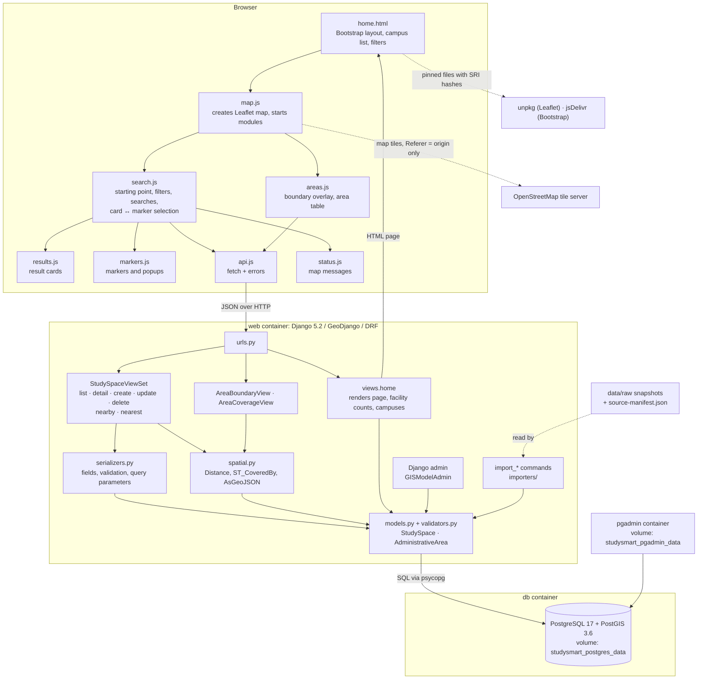
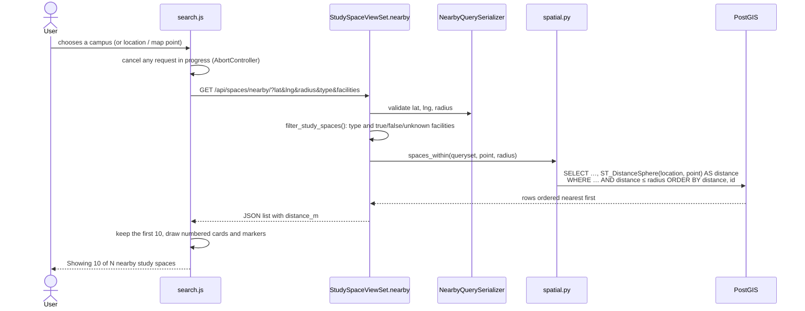

# Architecture

StudySmart is a three-tier web mapping application: a browser frontend, a Django/GeoDjango middle tier exposing a REST API, and a PostgreSQL/PostGIS database. All three run locally under Docker Compose. Spatial work (distances, radius filtering, nearest neighbour, containment and GeoJSON conversion) is done by PostGIS; the browser only displays results.

## Components

## Request flow: a nearby search

The list, nearest and area endpoints follow the same path. Each search is one database query; area coverage is one query plus one count per area.

## Frontend modules

The page is a Django template with native JavaScript ES modules: no framework, bundler or build step.

| Module | Responsibility |
| --- | --- |
| [map.js](../spaces/static/spaces/js/map.js) | Entry point: creates the Leaflet map and OpenStreetMap tile layer, starts the other modules |
| [search.js](../spaces/static/spaces/js/search.js) | Starting point (campus, geolocation, pick on map), filters, the three search modes, cancelling superseded requests, card–marker selection |
| [results.js](../spaces/static/spaces/js/results.js) | Numbered result cards, facility summaries, category illustrations, loading placeholders |
| [markers.js](../spaces/static/spaces/js/markers.js) | Marker icons, highlighting and stacking order, popups, distance formatting |
| [areas.js](../spaces/static/spaces/js/areas.js) | Boundary overlay and the per-area statistics table |
| [api.js](../spaces/static/spaces/js/api.js) | `fetchJson` with HTTP error handling |
| [status.js](../spaces/static/spaces/js/status.js) | Loading and error messages over the map |

API URLs reach the JavaScript through `data-` attributes rendered with ``, so no path is hard-coded. All text from the API is inserted with `textContent` or as DOM elements, never parsed as HTML.

## Backend modules

| Module | Responsibility |
| --- | --- |
| [models.py](../spaces/models.py) | `StudySpace` and `AdministrativeArea`, sharing an abstract `SourceRecord` with provenance fields; constraints (see [database.md](database.md)) |
| [validators.py](../spaces/validators.py) | Geometry validation used by the API, the admin and the imports |
| [serializers.py](../spaces/serializers.py) | API fields (`latitude`/`longitude` mapped to a PostGIS point), write validation through the model's `full_clean()`, protection of imported records, search-parameter validation |
| [views.py](../spaces/views.py) | Map page; `StudySpaceViewSet` (CRUD plus `nearby` and `nearest`); area views; query-string filters |
| [spatial.py](../spaces/spatial.py) | Every spatial query: radius, nearest, coverage counts and boundary GeoJSON |
| [universities.py](../spaces/universities.py) | Campus starting points with their OpenStreetMap element IDs |
| [admin.py](../spaces/admin.py) | Admin with map widgets, facility-correction rules and read-only provenance |
| [importers/](../spaces/importers/), [management/commands/](../spaces/management/commands/) | Snapshot import commands with checksum verification, validation and idempotent upserts |
| [studysmart/settings.py](../studysmart/settings.py) | Environment-based configuration; fails fast on missing secrets |

## Docker services

| Service | Image | Published port | Volume | Notes |
| --- | --- | --- | --- | --- |
| `web` | Built from [Dockerfile](../Dockerfile) (Python 3.12, GDAL/GEOS/PROJ) | `127.0.0.1:8000` | Source bind mount `.:/app` | Runs as an unprivileged user; waits for the database health check |
| `db` | `postgis/postgis:17-3.6` | none | `studysmart_postgres_data` | Health check with `pg_isready` |
| `pgadmin` | `dpage/pgadmin4:9.18.0` | `127.0.0.1:5050` | `studysmart_pgadmin_data` | Optional database browser |

All three share a dedicated bridge network (`studysmart_network`) with a configurable private subnet. Django reaches the database by its service name `db`. The database has no host port, and the two published ports listen on the loopback interface only.

## External services

| When | Service | Use |
| --- | --- | --- |
| In the browser, at run time | OpenStreetMap tile server | Base map tiles. The tile layer sends only the site origin as `Referer`, as the tile usage policy requires |
| In the browser, at run time | unpkg, jsDelivr | Leaflet 1.9.4 and Bootstrap 5.3.3 at pinned versions with Subresource Integrity hashes |
| Building the image | Docker Hub, PyPI, Debian | Base images and packages |
| Acquiring data (already done; snapshots committed) | Smart Dublin, Overpass API, Nominatim | Library and area files, café data, campus coordinates. Imports and tests make no network calls |

## Design decisions

| Decision | Reason | Trade-off |
| --- | --- | --- |
| Store all geometry in EPSG:4326 and measure with `ST_DistanceSphere` | Matches the sources and Leaflet; distances come back in metres with under 0.5% error at city scale; no transformation at query time | Radius searches are not index-assisted (a sequential scan of 657 rows takes milliseconds); a geography column or projected index would be needed at larger scale |
| Keep every spatial calculation in `spatial.py` and PostGIS | One place to read and test the spatial logic; the browser can never disagree with the database | One HTTP request per search |
| One `StudySpace` model for libraries and cafés, with an abstract `SourceRecord` | Same fields and queries for both types; provenance shared without a third table | Type-specific attributes would need nullable fields |
| No foreign key from study spaces to areas | Containment is computed with `ST_CoveredBy` when needed, so counts can never go stale after an import or edit | Coverage costs one count query per area (six in total) |
| Three-state facilities (`true` / `false` / unknown) with an import lock and evidence notes | Missing data must never be shown or filtered as "yes"; verified corrections survive re-imports | Filters return few results until better data exists |
| Commit the source snapshots with checksums; key imports on `(source_dataset, source_id)` | Anyone can reproduce the exact data; re-imports never duplicate; records are never silently deleted | The data is a dated snapshot, not a live feed |
| Imported records' source-owned fields are read-only, and imported records cannot be deleted (409) | The next import would silently undo such edits | Corrections to names or positions belong in the source data |
| Session authentication with Django model permissions; no Basic authentication | Keeps CSRF protection and avoids sending passwords on every request over HTTP | API writes need a browser session (via the admin login) |
| Native ES modules, `textContent` only, requests cancelled with `AbortController` | No build tooling; external text cannot inject markup; a slow earlier response cannot overwrite a newer search | Older browsers without module support are not supported |
| Campuses as a constant list, not a model | They are fixed search starting points, never study spaces or API data | Adding a campus is a code change |
| CI runs the project's own Compose stack; browser tests use no npm packages | CI matches local versions of GDAL, GEOS and PostGIS; no extra dependency tree to maintain | The CI job builds the image on every run (about a minute) |
| Self-hosted font, SRI-pinned CDN files, origin-only `Referer` for tiles | Fewer third-party requests; altered CDN files are refused; tile requests comply with policy without loosening the site's referrer policy | Pinned versions must be updated deliberately |

The security configuration (environment-only secrets, host checks, security headers, permissions and the `check --deploy` review) is described in [deployment.md](deployment.md#security-review).
