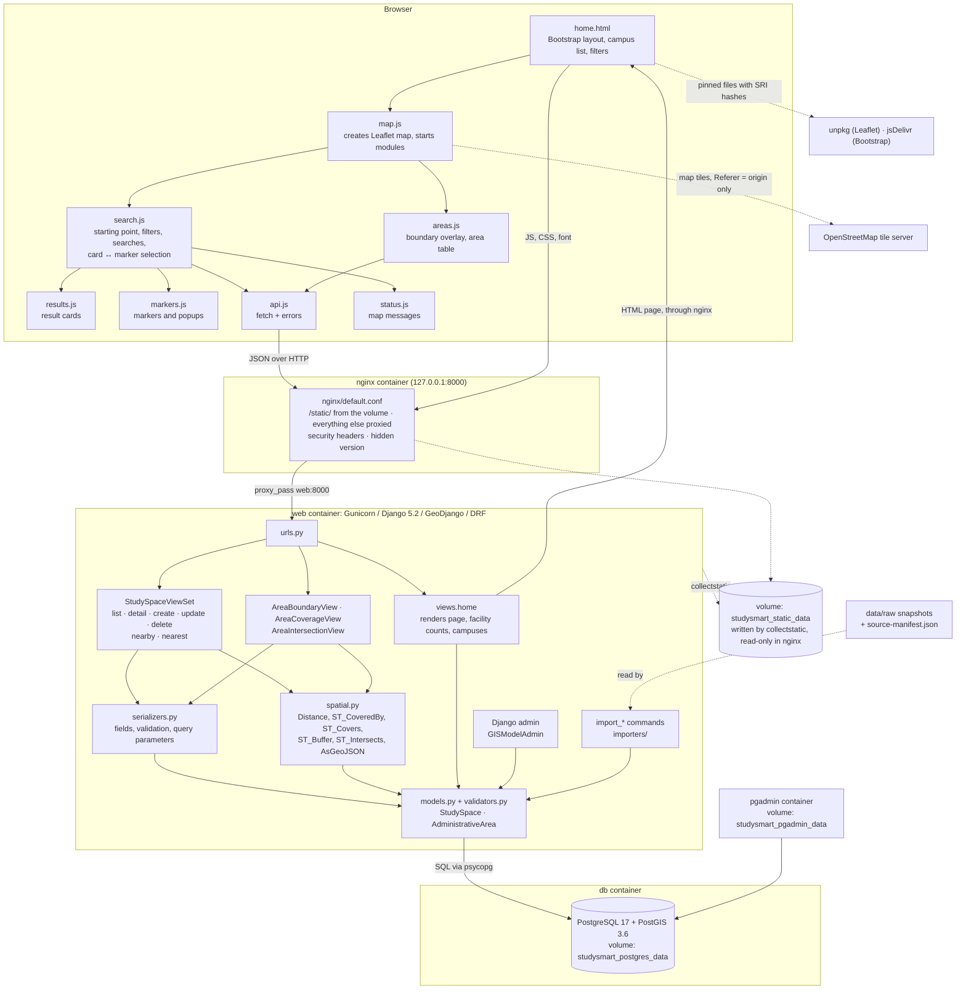

# Architecture

StudySmart is a three-tier web mapping application: a browser frontend, a Django/GeoDjango middle tier exposing a REST API, and a PostgreSQL/PostGIS database. The server side runs under Docker Compose, with Nginx as the only entry point in front of Gunicorn and Django. Spatial work (distances, radius filtering, nearest neighbour, containment, buffering, intersection and GeoJSON conversion) is done by PostGIS; the browser only displays results.

## Components



## Request flow: a nearby search

```mermaid
sequenceDiagram
    actor User
    participant JS as search.js
    participant Nginx as Nginx
    participant API as StudySpaceViewSet.nearby<br/>(in Gunicorn)
    participant Ser as NearbyQuerySerializer
    participant Sp as spatial.py
    participant DB as PostGIS

    User->>JS: chooses a campus (or location / map point)
    JS->>JS: cancel any request in progress (AbortController)
    JS->>Nginx: GET /api/spaces/nearby/?lat&lng&radius&type&facilities
    Nginx->>API: proxied, with Host and X-Forwarded-* headers
    API->>Ser: validate lat, lng, radius
    API->>API: filter_study_spaces(): type and true/false/unknown facilities
    API->>Sp: spaces_within(queryset, point, radius)
    Sp->>DB: SELECT …, ST_DistanceSphere(location, point) AS distance<br/>WHERE … AND distance ≤ radius ORDER BY distance, id
    DB-->>API: rows ordered nearest first
    API-->>Nginx: JSON list with distance_m
    Nginx-->>JS: response with security headers
    JS->>JS: keep the first 10, draw numbered cards and markers
    JS-->>User: Showing 10 of N nearby study spaces
    JS->>Nginx: GET /api/areas/intersecting/?lat&lng&radius (separate request)
    Nginx->>Sp: through AreaIntersectionView, validated by NearbyQuerySerializer
    Sp->>DB: ST_Covers(boundary, point)
    Sp->>DB: ST_Intersects(boundary, ST_Buffer(point::geography, radius)::geometry)
    DB-->>Nginx: containing area and areas reached, as JSON
    Nginx-->>JS: response with security headers
    JS-->>User: You're in South East; this search also reaches Central.
```

The list, nearest and area endpoints follow the same path. Each search is one database query; area coverage is one query plus one count per area, and the areas around a point take two queries. The area line is a separate request, so a failure there only hides that line.

## Frontend modules

The page is a Django template with native JavaScript ES modules: no framework, bundler or build step.

| Module | Responsibility |
| --- | --- |
| [map.js](../spaces/static/spaces/js/map.js) | Entry point: creates the Leaflet map and OpenStreetMap tile layer, starts the other modules |
| [search.js](../spaces/static/spaces/js/search.js) | Starting point (campus, geolocation, pick on map), filters, the three search modes, the line naming the areas a search reaches, cancelling superseded requests, card–marker selection |
| [results.js](../spaces/static/spaces/js/results.js) | Numbered result cards, facility summaries, category illustrations, loading placeholders |
| [markers.js](../spaces/static/spaces/js/markers.js) | Marker icons, highlighting and stacking order, popups, distance formatting |
| [areas.js](../spaces/static/spaces/js/areas.js) | Boundary overlay and the per-area statistics table |
| [api.js](../spaces/static/spaces/js/api.js) | `fetchJson` with HTTP error handling |
| [status.js](../spaces/static/spaces/js/status.js) | Loading and error messages over the map |

API URLs reach the JavaScript through `data-` attributes rendered with ``, so no path is hard-coded. All text from the API is inserted with `textContent` or as DOM elements, never parsed as HTML.

## Backend modules

| Module | Responsibility |
| --- | --- |
| [models.py](../spaces/models.py) | `StudySpace` and `AdministrativeArea`, sharing an abstract `SourceRecord` with provenance fields; constraints (see [database.md](database.md)) |
| [validators.py](../spaces/validators.py) | Geometry validation used by the API, the admin and the imports |
| [serializers.py](../spaces/serializers.py) | API fields (`latitude`/`longitude` mapped to a PostGIS point), write validation through the model's `full_clean()`, protection of imported records, search-parameter validation |
| [views.py](../spaces/views.py) | Map and About pages; `StudySpaceViewSet` (CRUD plus `nearby` and `nearest`); area views; query-string filters |
| [spatial.py](../spaces/spatial.py) | Every spatial query: radius, nearest, coverage counts, buffer and intersection, and boundary GeoJSON |
| [universities.py](../spaces/universities.py) | Campus starting points with their OpenStreetMap element IDs |
| [admin.py](../spaces/admin.py) | Admin with map widgets, facility-correction rules and read-only provenance |
| [importers/](../spaces/importers/), [management/commands/](../spaces/management/commands/) | Snapshot import commands with checksum verification, validation and idempotent upserts |
| [studysmart/settings.py](../studysmart/settings.py) | Environment-based configuration; fails fast on missing secrets |

## Docker services

| Service | Image | Published port | Volume | Notes |
| --- | --- | --- | --- | --- |
| `nginx` | `nginx:1.30.6-alpine` with [nginx/default.conf](../nginx/default.conf) | `127.0.0.1:8000` | `studysmart_static_data` (read-only) | Only entry point to the site: serves `/static/`, proxies the rest to `web:8000`, sets security headers |
| `web` | Built from [Dockerfile](../Dockerfile) (Python 3.12, GDAL/GEOS/PROJ) | none | Source bind mount `.:/app`; `studysmart_static_data` | Runs `collectstatic`, then Gunicorn with 3 workers, as an unprivileged user; waits for the database health check |
| `db` | `postgis/postgis:17-3.6` | none | `studysmart_postgres_data` | Health check with `pg_isready` |
| `pgadmin` | `dpage/pgadmin4:9.18.0` | `127.0.0.1:5050` | `studysmart_pgadmin_data` | Optional database browser |

All four share a dedicated bridge network (`studysmart_network`) with a configurable private subnet. Services reach each other by name (`web`, `db`). Gunicorn and the database have no host port, and the two published ports listen on the loopback interface only.

## External services

| When | Service | Use |
| --- | --- | --- |
| In the browser, at run time | OpenStreetMap tile server | Base map tiles. Both the main map and the admin's map widget send only the site origin as `Referer`, as the tile usage policy requires |
| In the browser, at run time | unpkg, jsDelivr | Leaflet 1.9.4 and Bootstrap 5.3.3 at pinned versions with Subresource Integrity hashes |
| Building the image | Docker Hub, PyPI, Debian | Base images and packages |
| Acquiring data (already done; snapshots committed) | Smart Dublin, Overpass API, Nominatim | Library and area files, café data, campus coordinates. Imports and tests make no network calls |

## Design decisions

| Decision | Reason | Trade-off |
| --- | --- | --- |
| Store all geometry in EPSG:4326 and measure with `ST_DistanceSphere` | Matches the sources and Leaflet; distances come back in metres with under 0.5% error at city scale; no transformation at query time | Radius searches are not index-assisted (a sequential scan of 657 rows takes milliseconds); a geography column or projected index would be needed at larger scale |
| Nginx in front of Gunicorn, sharing collected static files through a named volume | The site runs with `DEBUG` off; static files skip Python; Gunicorn is not exposed directly; Nginx never sees the source code or `.env` | Changed code or static files need `docker compose restart web`; file names have no content hash, so the static cache lifetime is a week rather than a year |
| Build the search buffer from the point cast to `geography`, then cast it back to `geometry` | The radius is in true metres while boundaries stay in EPSG:4326, with no schema change | The buffer is a polygon approximating a circle, up to about 0.5% short of the radius, so it can differ slightly from `ST_DistanceSphere` at the very edge |
| Keep every spatial calculation in `spatial.py` and PostGIS | One place to read and test the spatial logic; the browser can never disagree with the database | One HTTP request per search |
| One `StudySpace` model for libraries and cafés, with an abstract `SourceRecord` | Same fields and queries for both types; provenance shared without a third table | Type-specific attributes would need nullable fields |
| No foreign key from study spaces to areas | Containment is computed with `ST_CoveredBy` when needed, so counts can never go stale after an import or edit | Coverage costs one count query per area (six in total) |
| Three-state facilities (`true` / `false` / unknown) with an import lock and evidence notes | Missing data must never be shown or filtered as "yes"; verified corrections survive re-imports | Filters return few results until better data exists |
| Commit the source snapshots with checksums; key imports on `(source_dataset, source_id)` | Anyone can reproduce the exact data; re-imports never duplicate; records are never silently deleted | The data is a dated snapshot, not a live feed |
| Imported records' source-owned fields are read-only, and imported records cannot be deleted (409) | The next import would silently undo such edits | Corrections to names or positions belong in the source data |
| Session authentication with Django model permissions; no Basic authentication | Keeps CSRF protection and avoids sending passwords on every request over HTTP | API writes need a browser session (via the admin login) |
| Native ES modules, `textContent` only, requests cancelled with `AbortController` | No build tooling; external text cannot inject markup; a slow earlier response cannot overwrite a newer search | Older browsers without module support are not supported |
| Campuses as a constant list, not a model | They are fixed search starting points, never study spaces or API data | Adding a campus is a code change |
| CI runs the project's own Compose stack; browser tests use no npm packages | CI matches local versions of GDAL, GEOS and PostGIS; no extra dependency tree to maintain | The CI job builds the image on every run (about a minute) |
| Self-hosted font, SRI-pinned CDN files, origin-only `Referer` for tiles | Fewer third-party requests; altered CDN files are refused; tile requests comply with policy while public pages keep the stricter referrer policy; only `/admin/` pages, whose map widget cannot set its own, send their origin to other sites | Pinned versions must be updated deliberately |

The security configuration (environment-only secrets, host checks, security headers, permissions and the `check --deploy` review) is described in [deployment.md](deployment.md#security-review).

(This document was made with assistance from OpenAI Codex)
