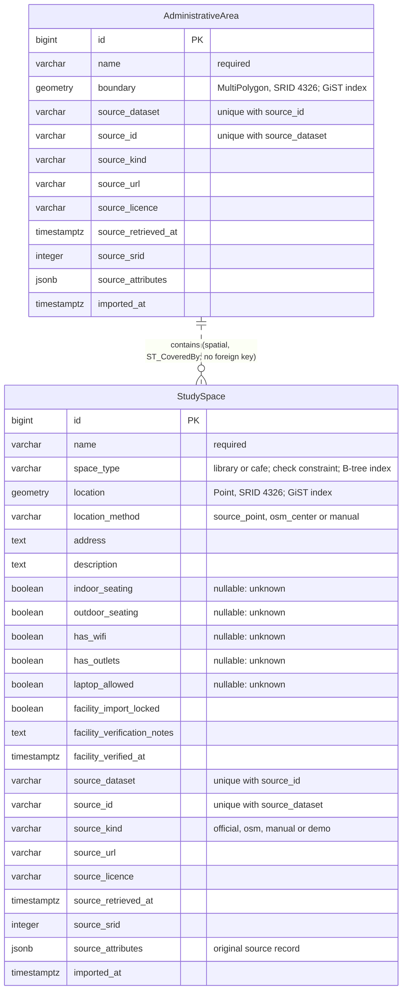

# Database

StudySmart stores its data in PostgreSQL 17 with PostGIS 3.6. The schema is defined by Django models in [spaces/models.py](../spaces/models.py) and created by one migration, [0001_initial.py](../spaces/migrations/0001_initial.py). The rest of the database (users, permissions, sessions, admin log) is Django's standard schema.

## Schema



### Models

Both models inherit the abstract `SourceRecord` class, which adds the provenance fields (`source_*` and `imported_at`) without creating a separate table.

**StudySpace**: one row per library or café.

| Field | Type | Rules |
| --- | --- | --- |
| `id` | bigint | Primary key |
| `name` | varchar(255) | Not blank |
| `space_type` | varchar(10) | `library` or `cafe`, enforced by a database check constraint |
| `location` | geometry(Point, 4326) | Two-dimensional, finite, within longitude/latitude ranges (`validate_point`) |
| `location_method` | varchar(20) | `source_point` (coordinates from the source), `osm_center` (approximate centre of an OSM way or relation) or `manual` |
| `address`, `description` | text | Optional |
| `indoor_seating`, `outdoor_seating`, `has_wifi`, `has_outlets`, `laptop_allowed` | boolean, nullable | `true` confirmed, `false` confirmed absent, `NULL` unknown |
| `facility_import_locked` | boolean | When true, imports do not change the five facilities |
| `facility_verification_notes` | text | Required while the lock is on |
| `facility_verified_at` | timestamptz | Set automatically when an administrator changes a facility |
| provenance fields | see below | |

**AdministrativeArea**: one row per Dublin City Council administrative area (five in the current data).

| Field | Type | Rules |
| --- | --- | --- |
| `id` | bigint | Primary key |
| `name` | varchar(255) | Not blank |
| `boundary` | geometry(MultiPolygon, 4326) | Two-dimensional, valid, within longitude/latitude ranges (`validate_boundary`) |
| provenance fields | see below | |

**Provenance fields** (both models)

| Field | Meaning |
| --- | --- |
| `source_dataset` | Which import produced the row: `dcc-libraries`, `osm-cafes`, `dcc-administrative-areas`, or `manual` |
| `source_id` | The record's stable identifier within that dataset, for example `way/970119309` or `ballyfermot-library`; a random UUID for manual records |
| `source_kind` | `official`, `osm`, `manual` or `demo` |
| `source_url`, `source_licence` | Where the record came from and its licence, kept for attribution |
| `source_retrieved_at` | When the source snapshot was downloaded |
| `source_srid` | The coordinate system of the original data (4326, or 2157 for the area boundaries) |
| `source_attributes` | The original source record, unchanged (CSV columns or OSM tags), plus any geometry-repair record |
| `imported_at` | When an import last created or changed the row |

### Relationships

There is **no foreign key** between `StudySpace` and `AdministrativeArea`. Which area contains a study space is a spatial relationship, computed with `ST_CoveredBy` when the area coverage endpoint is called. This keeps counts correct after any import or edit, with no stored value to go stale. A point exactly on a shared boundary is counted in both areas.

## Coordinate reference systems

- All stored geometry uses **EPSG:4326** (WGS 84 longitude/latitude), the coordinate system of the libraries, the OSM data and Leaflet. No transformation happens at query time.
- The administrative-area file is in **EPSG:2157** (Irish Transverse Mercator) and includes Z values. The import checks that the file's declared CRS matches the manifest, removes the Z dimension, transforms to EPSG:4326 with GDAL, converts polygons to multipolygons and validates the result. The original SRID is kept in `source_srid`.
- Two source boundaries are self-intersecting. They are imported only with the explicit `--repair-invalid` flag, which applies PostGIS `ST_MakeValid` and records the original validity reason in `source_attributes`.
- Points are built as `Point(longitude, latitude, srid=4326)`. The API exposes plain `latitude` and `longitude` fields, so clients never deal with axis order.
- Distances use `ST_DistanceSphere`, which returns metres for longitude/latitude geometry. Compared with the more exact spheroid, the error is under 0.5% at city scale.

## Indexes and constraints

Read from the running database (`pg_indexes`, `pg_constraint`):

| Table | Index or constraint | Kind | Purpose |
| --- | --- | --- | --- |
| `spaces_studyspace` | `spaces_studyspace_location_…_id` | GiST on `location` | Spatial index used by containment (`ST_CoveredBy`) |
| `spaces_studyspace` | `spaces_studyspace_space_type_…` | B-tree on `space_type` | Type filter |
| `spaces_studyspace` | `unique_study_space_source` | Unique (`source_dataset`, `source_id`) | No duplicate imports |
| `spaces_studyspace` | `valid_study_space_type` | Check | Only `library` or `cafe` |
| `spaces_administrativearea` | `spaces_administrativearea_boundary_…_id` | GiST on `boundary` | Spatial index for area queries |
| `spaces_administrativearea` | `unique_administrative_area_source` | Unique (`source_dataset`, `source_id`) | No duplicate imports |
| both | `…_pkey`; `…_source_srid_check` | Primary key; check `source_srid >= 0` | |

Geometry validity, coordinate ranges and finiteness are enforced by model validation (`full_clean()`), which the API, the admin and the imports all call before saving. They are not database constraints, so raw SQL could bypass them.

`ST_DistanceSphere` on `geometry` columns cannot use the GiST index, so radius and nearest searches scan the table (a few milliseconds for 657 rows). A geography column or a projected (ITM) expression index would make them index-assisted if the data grew substantially.

## Spatial queries

All spatial queries are in [spaces/spatial.py](../spaces/spatial.py):

| Operation | GeoDjango | PostGIS |
| --- | --- | --- |
| Radius search | `annotate(distance=Distance("location", point)).filter(distance__lte=D(m=radius))`, ordered by distance | `ST_DistanceSphere` |
| Nearest | The same distance annotation, ordered, `.first()` | `ST_DistanceSphere` with `LIMIT 1` |
| Area counts | `filter(location__coveredby=Subquery(boundary))`, grouped by `space_type` | `ST_CoveredBy` |
| Boundary GeoJSON | `annotate(geojson=AsGeoJSON("boundary", precision=5))` | `ST_AsGeoJSON` |

The same distance annotation is used to filter, order and report, so a returned `distance_m` never exceeds the requested radius. Type and facility filters are applied in the same query, before ordering.

## Data import

Three management commands load the committed snapshots in `data/raw/` (sources and licences in [data-sources.md](data-sources.md)):

```text
import_administrative_areas --repair-invalid   5 areas      (must run first)
import_libraries                               24 libraries
import_cafes                                   633 cafés
```

Each command:

1. Reads `data/source-manifest.json` and verifies the snapshot's **SHA-256 checksum** before reading any record.
2. Parses each record, builds the geometry, and validates it with the model's own `full_clean()`. Invalid records are reported and skipped; malformed files fail before any write.
3. For libraries and cafés, keeps only points covered by an imported area; these are reported as `outside`. Location imports refuse to run until all five areas exist.
4. **Upserts** on `(source_dataset, source_id)`. New records are created, changed records updated, identical records left untouched. Facility values are skipped for records whose facilities are locked.
5. Runs the whole file in one transaction. `--dry-run` rolls everything back; conflicting duplicate IDs abort the import.
6. Never deletes a record because it is missing from a newer snapshot.

Running the same import twice reports every record as `unchanged`, which was verified on a clean installation (see [deployment.md](deployment.md#clean-installation-verification)). Library records have no stable ID in the source CSV, so `data/library-identities.json` assigns fixed IDs with reviewed name aliases.

## Unknown, confirmed and verified facilities

| Status | How it is stored | Where it comes from |
| --- | --- | --- |
| Confirmed | `true` | An explicit positive source tag, for example OSM `indoor_seating=yes` or `internet_access=wlan` |
| Confirmed absent | `false` | An explicit negative source tag, for example `indoor_seating=no` |
| Unknown | `NULL` | Missing, ambiguous, conditional or conflicting source information |
| Verified by an administrator | Any value with `facility_import_locked = true`, notes and `facility_verified_at` | A correction through the admin or the API, with evidence notes; protected from later imports |

The API filter `<facility>=true` matches only confirmed values, and `unknown` matches only `NULL`. The interface never displays unknown as yes or no.

Current data (2026-10-30):

| Facility | Cafés: true / false / unknown | Libraries |
| --- | --- | --- |
| Indoor seating | 91 / 3 / 539 | all 24 unknown |
| Outdoor seating | 123 / 90 / 420 | all 24 unknown |
| Wi-Fi | 29 / 10 / 594 | all 24 unknown |
| Power outlets | 1 / 0 / 632 | all 24 unknown |
| Laptops allowed | 0 / 0 / 633 | all 24 unknown |

No record is currently administrator-verified, manual or demonstration data: every row is either `official` (Dublin City Council) or `osm` (OpenStreetMap). 112 cafés have an approximate position (`osm_center`); the other 521 cafés and all libraries use source coordinates.
